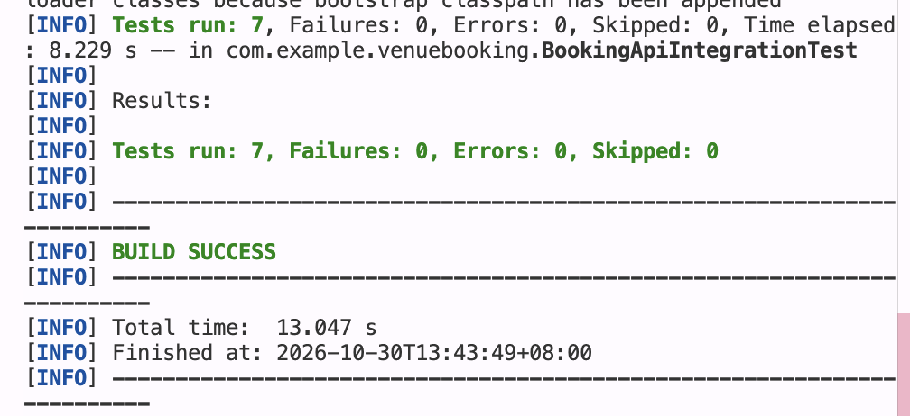
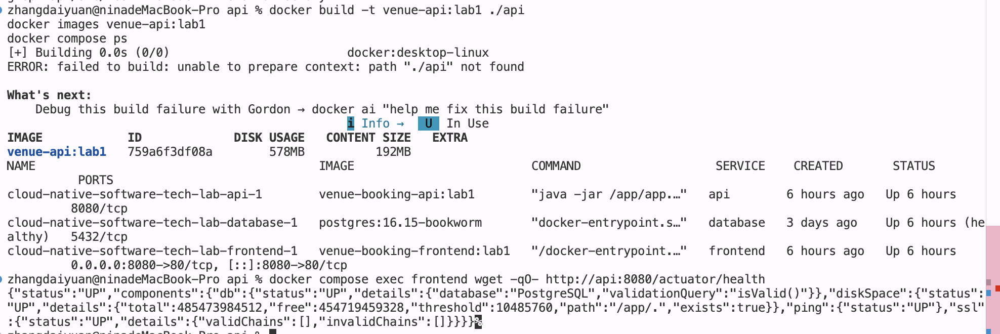

# 云原生软件技术 Lab 1 实验报告

## 项目运行方式

在仓库根目录准备 Docker Engine（或 Docker Desktop）及 Docker Compose v2。将 `.env.example` 复制为 `.env`，把 `POSTGRES_PASSWORD` 改为本地使用的密码；`FRONTEND_PORT` 默认为 `8080`，可按需调整。然后执行：

```sh
docker compose up --build -d
docker compose ps
docker compose logs --tail=100 frontend api database
```

使用浏览器访问 `http://localhost:8080/`；如修改了 `FRONTEND_PORT`，则使用相应端口。结束运行时执行 `docker compose down`，保留数据库命名卷中的数据。

## 1. 实验目标与系统架构

本实验完成可从源码重复构建的场地预约系统，并在 Docker Compose 中运行前端、Web API 和 PostgreSQL。浏览器经前端 Nginx 访问同源 `/api`；API 校验输入、场地状态与预约冲突，并将场地和预约保存到关系数据库。三个服务通过 Compose 网络通信，仅前端向宿主机发布端口。

| 服务 | 实现与职责 | 数据及配置 |
| --- | --- | --- |
| `frontend` | React 页面由 Nginx 提供，代理 `/api` 请求 | 只接收 HTTP JSON，不连接数据库 |
| `api` | Spring Boot 处理七个业务接口、事务与错误响应 | 从环境变量读取数据库连接；提供健康端点 |
| `database` | PostgreSQL 保存场地和预约 | Flyway 初始化与迁移；命名卷保留数据 |

用户可查询与创建场地、预约、查询和取消预约；API 拒绝无效输入、停用场地及重叠时段。取消采用逻辑取消，原记录仍可查询；取消后同一时段可重新预约。前后端各有独立 Dockerfile，数据库使用官方镜像。部署步骤、接口和验证结果分别见第 3、5–7 节。

## 2. 前端实现与用户交互

### 2.1 前端职责与技术结构

场地预约系统由前端、Web API 和关系数据库组成。前端负责展示场地与预约信息、接收用户输入，并通过 HTTP JSON 接口完成查询、创建和取消操作。业务规则的最终判定由 API 执行，场地与预约数据由关系数据库持久化；浏览器不直接连接数据库。

```text
浏览器 → frontend（Nginx） → api（Web API） → database（PostgreSQL）
             │
             └─ 静态页面；将 /api/* 请求代理至 api:8080
```

前端使用 React 19、TypeScript 7 和 Vite 8。`App.tsx` 管理场地、预约、表单草稿及操作反馈；`api/` 统一处理 HTTP 请求与响应校验；`validation/` 承担提交前的输入检查；`components/` 与 `pages/` 分别组织通用交互和业务视图。前端请求使用同源路径 `/api/...`。本地开发由 Vite 根据 `VITE_API_PROXY_TARGET` 转发请求，容器运行时由 Nginx 转发。

场地概览与预约记录是两个主视图。场地详情、预约详情和创建场地采用面板展示，并保留可直接访问和刷新的地址；预约表单使用独立页面，便于同时查看场地资料和提交反馈。详情面板支持键盘焦点管理与 `Esc` 关闭，关闭后返回原列表。预约记录将核心字段集中在条目中，减少逐条查阅时的页面滚动。

| 地址 | 功能 |
| --- | --- |
| `#/` | 查看场地列表、状态、位置、容量和开放时段 |
| `#/venues/new` | 创建开放或停用场地 |
| `#/venues/{id}` | 查询场地详情，并从开放场地进入预约 |
| `#/venues/{id}/book` | 查看选中场地并创建预约 |
| `#/reservations` | 查看、筛选和取消预约 |
| `#/reservations/{id}` | 查询预约详情与状态 |

### 2.2 用户功能与业务交互

#### 2.2.1 场地查询与创建

场地概览展示场地名称、编号、位置、容量、开放时段和状态。用户可打开详情面板查询完整信息；停用场地仍可查看，但不提供预约入口。创建场地时，用户填写名称、位置、容量、每日开放与关闭时间，并选择开放或停用状态。前端检查必填文本、字段长度、正整数容量和时间顺序。收到符合接口约定的 `201 Created` 响应后，页面显示新场地编号、清空表单并更新场地列表；创建失败时保留输入。

#### 2.2.2 预约创建

用户选择开放场地后，填写预约人或组织、日期、起止时间、参与人数和使用目的。前端检查日期是否有效、按北京时间计算的过去日期和当天时间、场地开放时段、人数上限、起止时间顺序，以及文本必填与长度限制。前端不独立判定预约时段是否冲突；API 对场地状态、输入和时间冲突作最终校验。仅在收到符合约定的 `201 Created` 响应后，页面显示服务器生成的预约编号并清空表单。

#### 2.2.3 预约查询与取消

预约列表同时展示有效和已取消记录，条目包含场地名称与编号、日期与时间、预约人或组织、人数、用途及状态。状态筛选和每页六条的分页在浏览器中完成，不改变 API 返回的列表数据。预约详情通过独立接口查询，展示完整记录及创建、取消时间。

取消有效预约前，界面要求二次确认；选择“保留预约”不会发送取消请求。确认后，前端依据 API 返回的 `CANCELLED` 状态更新记录。已取消记录仍可查询，但不再提供取消操作。重新进入预约记录页时会读取服务器数据；刷新失败时保留上次成功获取的记录，并明确提示其可能不是最新。

### 2.3 API 调用与异常反馈

前端按公共接口约定使用 `snake_case` JSON 字段。预约日期和日内时间分别发送为 `YYYY-MM-DD`、`HH:mm`；创建和取消时间采用 API 返回的带时区时间戳。浏览器原生日期、时间控件的显示格式不影响请求格式。

| 请求 | 用途 | 成功响应 |
| --- | --- | --- |
| `GET /api/venues` | 查询场地列表 | `200`，场地数组 |
| `GET /api/venues/{id}` | 查询场地详情 | `200`，场地对象 |
| `POST /api/venues` | 创建场地 | `201`，含服务器生成编号的场地对象 |
| `GET /api/reservations` | 查询预约记录 | `200`，预约数组 |
| `GET /api/reservations/{id}` | 查询预约详情 | `200`，预约对象 |
| `POST /api/reservations` | 创建预约 | `201`，含服务器生成编号的预约对象 |
| `POST /api/reservations/{id}/cancel` | 取消预约 | `200`，状态为 `CANCELLED` 的预约对象 |

对参数错误、资源不存在和时间冲突，页面分别展示 API 的 `400`、`404`、`409` 响应所附的可读信息；字段校验详情会转换为对应的中文字段提示。服务端故障显示通用错误，不展示内部异常。网络中断或成功响应结构异常时，页面提示用户先刷新场地或预约列表核对结果，再决定是否重试，避免结果不确定时重复创建。提交期间禁用表单与重复操作。前端校验用于及时反馈，不能替代 API 的业务校验与并发冲突控制。

### 2.4 前端容器化实现

`frontend/Dockerfile` 采用两阶段构建。构建阶段基于 `node:24.15.0-alpine3.23`，使用锁定依赖执行 `npm ci`，再通过 `npm run build` 完成 TypeScript 检查和 Vite 构建。运行阶段基于 `nginx:1.28.2-alpine3.23`，只复制静态构建产物与 Nginx 配置，监听容器内 `80` 端口。`.dockerignore` 排除本地依赖、缓存、构建产物、Git 数据、日志和环境变量文件。

Nginx 提供静态页面，并将 `/api/` 请求代理至 Compose 网络中的 `http://api:8080`。配置使用原始请求 URI，保留 `/api` 前缀；`try_files $uri $uri/ /index.html` 为页面地址提供回退。浏览器始终使用同源 API 路径，前端构建产物无需写入后端容器地址。

### 2.5 前端验证与界面展示

#### 2.5.1 自动验证

在 Node.js 24.15.0 环境中，`npm test` 的 123 项 Vitest 测试、`npm run test:layout` 的 8 项 Playwright/Chromium 测试全部通过，`npm run build` 完成类型检查与生产构建。测试覆盖场地创建、详情查询、预约创建与取消、输入校验、服务端错误提示、冲突后取消并重新预约，以及页面布局与交互。浏览器交互测试使用可控 HTTP 响应，检验前端对各类接口结果的处理。

#### 2.5.2 界面展示


图 1：场地概览展示位置、容量、开放时段与状态，停用场地没有预约入口。


图 2：场地详情面板展示场地编号和完整基本信息。


图 3：创建场地成功后显示新场地编号及后续预约入口。


图 4：预约成功后显示预约编号，并提供查看预约记录的入口。


图 5：时间冲突时保留表单输入，并显示明确的失败信息。


图 6：预约列表同时展示有效与已取消记录，支持按状态筛选。


图 7：预约详情展示场地、预约人、时段、状态与创建时间。


图 8：取消成功后记录保留，状态更新为“已取消”。

### 2.6 前端实现小结

前端覆盖了场地列表与详情、创建场地、创建预约、预约列表与详情、取消预约，以及成功、参数错误和时间冲突提示。以服务器响应为数据事实、按接口约定校验响应、在结果不确定时提示核对记录，使页面状态与业务结果保持一致。可直接访问的详情地址、连续的表单操作、紧凑的记录布局和自动化回归测试，提高了场地预约流程的可用性与可验证性。

## 3. 后端 API 与业务逻辑

### 3.1 技术结构与数据职责

后端使用 Java 17、Spring Boot 3.4.5、Spring Web、Jakarta Validation、Spring Data JPA 和 PostgreSQL 16。代码按 `Controller → DTO → Service → Repository → PostgreSQL` 分层：Controller 接收 HTTP 请求并返回状态码与 `Location`；DTO 定义公开的输入输出；Service 执行业务校验、事务和状态变更；Repository 查询和保存 JPA 实体。`GlobalExceptionHandler` 集中转换业务异常，Actuator 提供 `/actuator/health`。

数据库结构由 Flyway 的 V1 建表迁移管理，V2 写入演示场地，V3 收紧四个必填文本字段的非空白约束；应用启动时执行迁移，JPA 使用 `ddl-auto=validate` 检查实体与表结构，不自动建表。场地与预约分别对应 `venues`、`reservations`，预约通过非空 `venue_id` 外键关联场地。公开 JSON 使用 UTF-8、`snake_case` 字段、`YYYY-MM-DD` 日期和 `HH:mm` 日内时间；`created_at`、`cancelled_at` 为带时区的 ISO 8601 时间戳。业务日期按 `Asia/Shanghai` 判断，数据库的 `TIME WITHOUT TIME ZONE` 保持本地钟点值，不做时区偏移换算。

### 3.2 API 设计

七个接口均以 `/api` 开头，列表直接返回数组；场地列表按 `id` 升序，预约列表按 `id` 降序且包含已取消记录。

| 方法与路径 | 用途 | 成功响应 | 主要错误 |
| --- | --- | --- | --- |
| `GET /api/venues` | 查询场地列表 | `200`，场地数组 | `500` |
| `GET /api/venues/{id}` | 查询场地详情 | `200`，场地对象 | `400` 无效 ID；`404` 场地不存在 |
| `POST /api/venues` | 创建场地 | `201`，场地对象；`Location: /api/venues/{id}` | `400` 输入无效 |
| `GET /api/reservations` | 查询预约列表 | `200`，预约数组 | `500` |
| `GET /api/reservations/{id}` | 查询预约详情 | `200`，预约对象 | `400` 无效 ID；`404` 预约不存在 |
| `POST /api/reservations` | 创建预约 | `201`，预约对象；`Location: /api/reservations/{id}` | `400` 输入或业务时间无效；`404` 场地不存在；`409` 场地停用或时段冲突 |
| `POST /api/reservations/{id}/cancel` | 逻辑取消预约 | `200`，取消后的预约对象 | `400` 无效 ID；`404` 预约不存在 |

### 3.3 核心业务规则

- **场地状态与容量：**创建场地时校验名称、位置、正整数容量和开放时间顺序；省略 `status` 时默认为 `OPEN`。`CLOSED` 场地仍可查询，但不能接受预约。预约人数须满足 `1 ≤ attendee_count ≤ venue.capacity`。
- **日期与开放时段：**预约日期不能早于上海时区的当天；预约当天时，开始时间须晚于当前本地时间。每条预约须满足 `venue.open_time ≤ start_time < end_time ≤ venue.close_time`，只允许同一自然日内的时段。
- **时间冲突：**仅比较同一场地、同一日期的 `ACTIVE` 预约。预约区间采用半开形式 `[start_time, end_time)`；冲突条件为 `existing.start_time < request.end_time && existing.end_time > request.start_time`。因此 `10:00–11:00` 与 `11:00–12:00` 相邻可预约，实际重叠则返回 `409 TIME_CONFLICT`。
- **逻辑取消：**取消保留原记录，将 `status` 改为 `CANCELLED` 并写入 `cancelled_at`。重复取消返回同一已取消记录和原取消时间，保持幂等；已取消记录不占用时段，同一时段可以重新预约。

### 3.4 并发控制

创建预约在同一个 `@Transactional` 事务内执行：通过 `PESSIMISTIC_WRITE` 锁定目标 `venue` 行 → 校验场地与请求 → 查询冲突的 `ACTIVE` 预约 → 无冲突才插入并提交。PostgreSQL 使用默认 `READ COMMITTED` 隔离级别。同一场地的并发请求在场地行锁处排队；先提交的预约会进入后一个请求的冲突查询，因此不能都成功。取消时也先锁场地，再锁预约并更新状态，保持一致的加锁顺序。

真实 PostgreSQL 的并发集成测试同时发出两次相同预约请求，结果为一个 `201`、一个 `409 TIME_CONFLICT`，完成后数据库中该场地只有一条匹配的 `ACTIVE` 预约。测试还验证取消后同一时段能再次预约，覆盖业务正确性与并发正确性。

### 3.5 统一错误响应

后端通过统一异常处理返回稳定的错误结构，不向客户端暴露堆栈、SQL 或环境变量。例如时间冲突返回：

```json
{
  "error": {
    "code": "TIME_CONFLICT",
    "message": "该场地在所选时段已被预约"
  }
}
```

`400 VALIDATION_ERROR` 处理无效 JSON、字段、容量和日期时间，可附字段级 `details`；`404 VENUE_NOT_FOUND` 与 `404 RESERVATION_NOT_FOUND` 处理不存在的资源；`409 VENUE_CLOSED` 与 `409 TIME_CONFLICT` 处理业务冲突；意外故障返回 `500 INTERNAL_ERROR`。

### 3.6 容器化与验证

`api/Dockerfile` 使用 Maven/JDK 17 构建阶段从源码下载依赖并打包，再用 JRE 17 运行阶段只携带应用 jar，以非 root 用户在容器内监听 `8080`。数据库连接由 `SPRING_DATASOURCE_URL`、`SPRING_DATASOURCE_USERNAME`、`SPRING_DATASOURCE_PASSWORD` 注入；Compose 中 JDBC 地址使用 `database:5432`，镜像内不写入密码。`/actuator/health` 可报告应用和数据库健康状态。

2026-10-30，后端使用 `postgres:16.15-bookworm` Testcontainers 运行的 7 项集成测试全部通过，覆盖七个接口、状态码与错误码、输入校验、相邻时段、逻辑取消与重新预约、真实并发冲突，以及 JVM 默认时区为 UTC 时 `TIME` 字段与数据库值一致。当时测试启动时 Flyway V1/V2 成功执行，JPA `validate` 通过；健康检查返回应用 `UP`、数据库 `UP`。实际执行 `docker compose up --build -d` 成功构建并启动 API 镜像，容器内健康检查同样为 `UP`。当前源码增加的测试与 V3 迁移结果见第 10 节。



图 9：`BookingApiIntegrationTest` 的 7 项测试全部通过，失败、错误和跳过数均为 0，Maven 构建结果为 `BUILD SUCCESS`。



图 10：截图显示现有 API 镜像、Compose 三个服务运行，以及 `/actuator/health` 返回应用和数据库均为 `UP`。

## 4. 数据库设计

### 4.1 数据模型与字段

C 使用 PostgreSQL 16，业务表为 `venues` 与 `reservations`。一个场地对应多条预约，`reservations.venue_id` 是引用 `venues(id)` 的非空外键；两表主键均为数据库生成的 `BIGINT` identity。种子插入不指定 ID，后续 API 写入继续使用数据库序列。

| 表 | 关键字段与存储方式 |
| --- | --- |
| `venues` | `name VARCHAR(100)`、`location VARCHAR(200)`、`capacity INTEGER`、`open_time/close_time TIME WITHOUT TIME ZONE`、`status VARCHAR(10)` |
| `reservations` | `venue_id BIGINT`、`booked_by VARCHAR(100)`、`reservation_date DATE`、`start_time/end_time TIME WITHOUT TIME ZONE`、`attendee_count INTEGER`、`purpose VARCHAR(500)`、`status VARCHAR(10)`、`created_at/cancelled_at TIMESTAMP WITH TIME ZONE` |

业务日期和日内钟点按 `Asia/Shanghai` 解释；创建与取消时间保存实际时间点。取消不删除行，`CANCELLED` 记录继续关联原场地，便于查询历史。外键没有级联删除配置。

### 4.2 数据库约束与索引

除 `cancelled_at` 外，业务列均要求非空；四种文本不能为空白，长度由 `VARCHAR` 上限约束。`capacity`、`attendee_count` 必须大于 0；开放时间、预约起止时间分别满足前者小于后者。场地状态仅允许 `OPEN/CLOSED`，预约状态仅允许 `ACTIVE/CANCELLED`；`ACTIVE` 必须没有取消时间，`CANCELLED` 必须有取消时间。场地和预约默认状态分别为 `OPEN`、`ACTIVE`，创建时间默认 `CURRENT_TIMESTAMP`。

联合索引 `idx_reservations_conflict` 按 `(venue_id, reservation_date, status, start_time, end_time)` 建立，辅助有效预约的冲突查询。索引本身不阻止时段重叠；容量上限、开放时段、过去时间和并发冲突由 B 的 Service 及事务锁处理，见第 3 节。

### 4.3 Flyway 管理与独立验证

迁移位于 `api/src/main/resources/db/migration/`：V1 创建两张表、14 项命名约束及冲突索引；V2 插入两个开放场地和一个停用场地，不预置预约；V3 保留原约束名，更新四个文本非空白检查。Flyway 是结构唯一来源，由 API 启动时执行，JPA 使用 `ddl-auto=validate`。不另用数据库初始化目录或 JPA 自动建表；已执行迁移不回改，结构变化新增版本。

2026-10-30，C 的独立 PostgreSQL/Flyway 验证确认：当时的 V1/V2 两项迁移成功，`validate` 与再次 `migrate` 成功，种子未重复；21 组非法写入被预期 SQLSTATE 类别拒绝。合法文本长度边界、identity、默认值、逻辑取消和有预约引用时的外键删除保护均通过。该组测试在独立项目中回滚测试写入，保留三条种子，不与后续完整系统验收数据混用。独立工具使用 Flyway Community 11.20.0；应用使用 B 的 Maven 依赖配置，两者验证范围分开记录。V3 的新增验证见第 10 节。

## 5. Docker 与 Compose 配置

### 5.1 C 的三服务编排

前后端 Dockerfile 分别由 A、B 提供，其构建与运行阶段见第 2.4、3.6 节。C 在根目录维护唯一一份 `compose.yaml`；数据库直接使用 `postgres:16.15-bookworm` 官方镜像，不编写第三个 Dockerfile。

```text
浏览器 → 宿主机 8080 → frontend:80
                         │ /api/*，保留原路径
                         ▼
                       api:8080
                         │ JDBC
                         ▼
                     database:5432
                         │
                     postgres_data
```

| 服务 | 构建或镜像 | 端口与职责 |
| --- | --- | --- |
| `frontend` | `./frontend` → `venue-booking-frontend:lab1` | 容器内 80；映射 `${FRONTEND_PORT:-8080}:80` |
| `api` | `./api` → `venue-booking-api:lab1` | 容器内 8080；不发布宿主机端口 |
| `database` | `postgres:16.15-bookworm` | 容器内 5432；不发布宿主机端口 |

三个服务使用 Compose 默认网络，通过固定服务名互相访问。API 等待数据库 `service_healthy` 后启动，前端等待 API 的 `/actuator/health` 通过后启动。数据库 healthcheck 使用 `pg_isready` 经本地 TCP 检查，间隔 5 秒、超时 5 秒、启动宽限 10 秒、重试 12 次。API 健康检查通过 HTTP 确认应用及数据库连接均可用；此等待方式于 2026-10-31 修订，早期验收记录对应修订前配置。

### 5.2 配置外部化与命名卷

根目录 `.env.example` 提供四个变量：`POSTGRES_DB`、`POSTGRES_USER`、`POSTGRES_PASSWORD`、`FRONTEND_PORT`。真实 `.env` 仅保存在本机，被 Git 忽略。本次实际配置使用数据库名与用户名 `venue_booking`、随机实验密码和前端端口 `8080`；密码未写入镜像或报告证据。

Compose 显式向数据库传入三个 `POSTGRES_*` 变量，向 API 注入 `SPRING_DATASOURCE_URL/USERNAME/PASSWORD`。JDBC URL 为 `jdbc:postgresql://database:5432/${POSTGRES_DB}`；Compose 读取 `.env` 只用于变量替换，不意味着容器自动获得文件内全部变量。三个数据库变量为空时，配置解析直接失败。

`postgres_data` 命名卷挂载到 `/var/lib/postgresql/data`。本次默认项目名为 `cloud-native-software-tech-lab`，实际卷名为 `cloud-native-software-tech-lab_postgres_data`，容器删除后该卷仍保留。healthcheck 中的 `$$POSTGRES_USER`、`$$POSTGRES_DB` 留到容器内展开。数据库接受连接的检查之外，另由 Actuator 验证 API 到数据库的连接。

## 6. 系统部署与功能验收

### 6.1 C 的整体启动记录

2026-10-30，C 在 ARM64 Mac 上使用 Docker Engine 29.2.1、Compose v5.1.0，从 `e2446b6` 源码执行统一部署。后续合并到 `d185d5e` 的内容仅为报告、截图和 `api/.gitignore`，应用及部署实现未变。

首次配置时复制 `.env.example` 为 `.env` 并替换密码，已有配置不覆盖。根目录执行：

```sh
docker compose config --quiet
docker compose up --build -d
docker compose ps
docker compose logs --tail=100 frontend api database
docker compose exec -T frontend wget -qO- http://api:8080/actuator/health
```

前后端镜像均从仓库源码构建成功，三个服务正常运行，数据库为 `healthy`，仅前端发布宿主机端口。API 日志确认空库成功应用 V1/V2、JPA 初始化完成、Spring Boot 启动成功；实际 JDBC URL 为 `jdbc:postgresql://database:5432/venue_booking`。Actuator 顶层与数据库健康状态均为 `UP`。浏览器入口为 `http://localhost:8080/`，首页和经 Nginx 转发的 `/api/venues` 均返回 `200`。

### 6.2 C 提供的联调一手证据

整体环境运行后，C 经前端入口执行 33 项真实 HTTP 检查，覆盖七个业务接口、主要校验错误、相邻时段、冲突、取消、幂等和重订；并发请求结果为一个 `201`、一个 `409 TIME_CONFLICT`，SQL 核对仅一条对应 `ACTIVE`。此数量与 B 的 7 项 Testcontainers 集成测试分别记录；本次 Dockerfile 构建跳过测试，不将镜像构建结果当作重新执行集成测试。

Chrome 实际页面操作另验证了创建场地、列表与详情、预约成功、冲突提示、二次确认取消、同时间重订及刷新详情。页面验收场地为 #5，日期为 `2026-11-06`，时段为 `10:00–11:00`；原预约 #5 取消并保留，新预约 #6 为有效状态。完整记录见[真实 API 与页面验收 JSON](assets/lab1-report/stage4-acceptance.json)；该记录属于 C 在 2026-10-30 的本机联调证据。

## 7. 并发与数据持久化验证

### 7.1 C 的容器重建持久化验证

C 在 2026-10-30 14:58:48（北京时间）保存预约 #5、#6 的完整 API 响应，记录场地/预约总数、Flyway 历史、容器 ID、镜像 ID 和命名卷信息，然后执行：

```sh
docker compose down
docker compose up -d
docker volume ls
```

全程不使用 `-v`。`down` 后确认三个旧容器已移除，原数据库卷仍存在；14:59:54 完成重建后核对。三个容器 ID 均变化、镜像 ID 均未变，数据库继续挂载原 `cloud-native-software-tech-lab_postgres_data`，卷创建时间与挂载位置不变。

| 对比项 | 重建前 | 重建后 |
| --- | --- | --- |
| 预约 #5 | `CANCELLED`，有取消时间 | 完整记录一致 |
| 预约 #6 | `ACTIVE`，取消时间为空 | 完整记录一致 |
| 场地总数 / 预约总数 | 5 / 6 | 5 / 6 |
| Flyway 历史 | V1、V2 成功，校验和已记录 | 版本和校验和未变，无需重复迁移 |
| 应用与数据库健康 | `UP / UP` | `UP / UP` |

“完整记录一致”包含预约人、用途、日期、钟点、状态及创建/取消时间，而非仅判断同一编号存在。重建后通过 HTTP 重新查询并与 SQL 核对，API 启动日志无 `ERROR`。本次证明本地 Compose 环境的命名卷能在容器重建后保留预约，不包含备份恢复或生产高可用验证。

证据见[重建前后对比 JSON](assets/lab1-report/stage5-persistence.json)及[重建后状态与日志](assets/lab1-report/deployment-status.txt)。正式验收卷与早期 `lab1-db-check-*` 独立验证卷分开，验收数据保留。

## 8. 小组分工

小组按前端、后端、数据库与部署三个组件分工；以下交付内容可由仓库文件和本报告对应章节核对。

| 成员 | 交付内容 | 报告位置 |
| --- | --- | --- |
| A：前端 | React 页面、API 调用与交互测试；前端 Dockerfile、Nginx 代理和界面截图 | 第 2 节 |
| B：后端 | 七个业务接口、输入校验、预约事务与错误响应；后端 Dockerfile 和 PostgreSQL 集成测试 | 第 3 节 |
| C：数据库与部署 | V1/V2 数据库迁移、种子与独立验证脚本；Compose、环境变量模板、部署联调和持久化验收记录 | 第 4–7 节 |

2026-10-31 的复核修订另补充了并发取消、接口响应、输入校验、启动就绪与 V3 数据库约束的修复和验证，记录见第 10 节；这些修订不改写原始分工和验收证据。

## 9. 实验总结

系统实现了任务书规定的场地与预约查询、创建、取消和冲突拒绝流程。前端通过 HTTP JSON 与 API 通信，API 使用 PostgreSQL 持久化数据；Compose 可从源码构建三服务，环境变量提供数据库配置，命名卷在容器重建后保留预约。本报告记录了接口、数据库结构、镜像与编排、页面流程、并发和持久化验证，以及复核阶段的修订。

本实验验证的是本地 Docker Compose 部署与课程要求的业务流程。Worker、Kubernetes 编排和可观测性属于后续 Lab；本阶段没有验证生产环境的备份恢复或高可用能力。

## 10. 问题与解决过程

### 后端：日内时间因时区配置发生偏移

联调时发现，数据库 `TIME WITHOUT TIME ZONE` 列中的场地开放时间、预约起止时间，与 API 返回的钟点可能相差 8 小时。排查发现 `application.yml` 设置了 `hibernate.jdbc.time_zone: Asia/Shanghai`，而容器 JVM 默认时区为 UTC；`LocalTime` 表示不带时区的日内时间，不应按时区转换。处理时移除了这项 Hibernate JDBC 时区配置，仍使用 `Asia/Shanghai` 的业务时钟判断“今天”和当天预约是否过时，带时区的创建、取消时间继续按实际时间点保存。

新增的 PostgreSQL Testcontainers 回归测试在 JVM 默认时区为 UTC 时，核对 Flyway 种子场地、新建场地和预约的 API 时间与数据库原始 `TIME` 值一致，并比较 `created_at`、`cancelled_at` 的时间点。修复后的 7 项集成测试全部通过。配置修复不会自动更正此前可能受影响的持久化记录；旧记录须依据原始预约意图逐条核对。

### 后端：并发请求可能同时通过冲突检查

如果创建预约只执行“查询冲突 → 插入”，两个请求可能在对方提交前都查到空结果，造成同一时段重复预约。后端把场地行的 `PESSIMISTIC_WRITE` 锁、业务校验、冲突查询和插入放在同一事务中；取消操作也先锁场地，再修改预约，保持加锁顺序一致。真实 PostgreSQL 并发测试同时提交两个相同请求，得到一个 `201` 和一个 `409 TIME_CONFLICT`，最终仅有一条匹配的 `ACTIVE` 预约。

### C：首次构建下载与本机代理排查

首次统一构建在 Docker Hub 认证请求处超时，尚未开始源码编译。通过 Docker 引擎预拉取原 Dockerfile 使用的 Node、Nginx、Maven、JRE 镜像后重试成功，未改代码、镜像标签或系统网络设置。后端 `dependency:go-offline` 首次预下载约 612 秒，随后编译打包约 13 秒，构建耗时主要来自依赖下载。

启动后宿主机 Python HTTP 检查曾返回 `502`；通过禁用该请求的代理直接访问，首页和 `/api/venues` 均为 `200`，Nginx 访问日志一致，因而未修改应用或代理配置。独立数据库验证工具的 AMD64 模拟仅用于其 Flyway CLI 镜像，正式三服务使用本机架构。

### 2026-10-31 功能复核与修订

复核发现同时取消同一预约时，多个请求可能在加锁前读取旧状态，导致 `cancelled_at` 被重复改写。取消流程现先查询场地编号、锁定场地，再读取并锁定预约；回归测试同时发起 8 次取消，确认所有响应和最终记录保留同一个取消时间。创建接口改为返回相对 `Location`，经前端代理访问时仍可正确定位详情；必填文本校验也拒绝仅含不间断空格或零宽空格的输入，并将含 NUL 字符的输入作为 `400 VALIDATION_ERROR` 处理。

部署启动顺序改为前端等待 API 健康检查通过。修订后在独立 Compose 项目中从源码构建并启动三服务，API 与数据库均为 `healthy`；经前端入口执行的 14 项 HTTP 回归检查全部通过。补充 NUL 字符校验后，经前端入口核对两项正常创建及四个必填文本字段的 NUL 校验，6 项 HTTP 检查全部通过。

数据库层复核发现，原有 `CHECK` 会放行仅含不间断空格或零宽空格的文本。新增 Flyway V3，以 Java 17 `Character.isWhitespace`、`isSpaceChar`、`FORMAT` 字符集合为准更新四个约束。13 项 PostgreSQL Testcontainers 集成测试全部通过：直接 SQL 写入不可见文本被四个约束拒绝，V2 数据库中的正常场地和预约在升级 V3 后保留。全新独立 Compose 部署成功执行 V1–V3，数据库与 API 均为 `healthy`；经前端入口完成场地列表、创建场地、创建预约与取消预约 4 项 HTTP 检查。若旧库存在仅含不可见字符的记录，V3 会拒绝迁移；须先核查并修正旧数据，不自动改写业务记录。以上结果属于本次修订的验证，不覆盖或改写 2026-10-30 的原始验收记录。

最终复核在 Windows、Docker Engine 29.1.3、Compose v2.40.3-desktop.1 环境执行。从前端锁文件重新运行 `npm ci`，123 项 Vitest 测试、8 项 Playwright/Chromium 页面测试及生产构建均通过。独立 Compose 环境从当前源码构建三服务，经前端代理完成 20 项实际 HTTP 检查，覆盖七个业务接口、错误响应、时段冲突、取消幂等和取消后重订；真实 Chromium 页面操作完成创建场地、创建预约、冲突提示、取消与同时间重订，未见页面运行错误。执行 `docker compose down` 后用原命名卷重启，场地及取消、重订预约的记录仍一致，API 与数据库健康，服务日志未见持续错误。本次独立验证项目与 2026-10-30 的原始验收环境分开。

独立数据库验证脚本同步适配 V3，并在 Windows 子进程中显式使用 UTF-8。运行 `python scripts/verify-database.py` 后，空库成功执行 V1–V3，Flyway `validate` 与第二次 `migrate` 通过，种子未重复；29 组非法写入按预期 SQLSTATE 类别被拒绝，合法边界、默认值、逻辑取消和外键保护通过，测试写入已回滚。该脚本只验证数据库与迁移，不代替上面的真实三服务验收。
