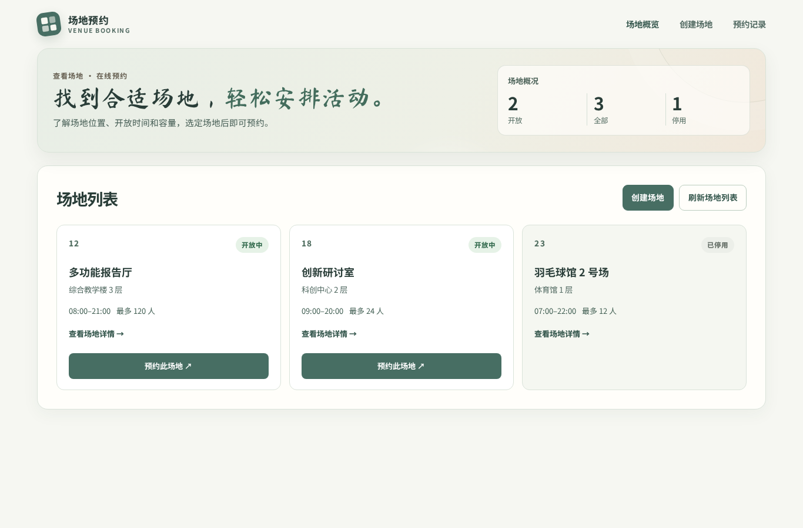
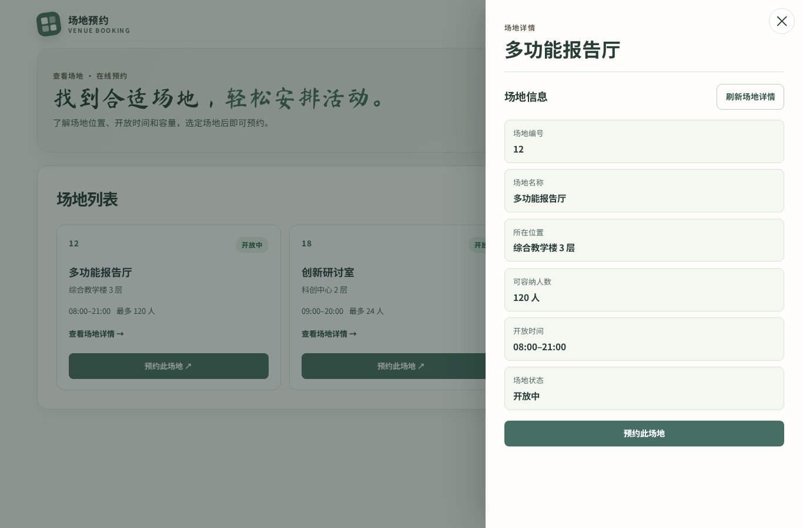
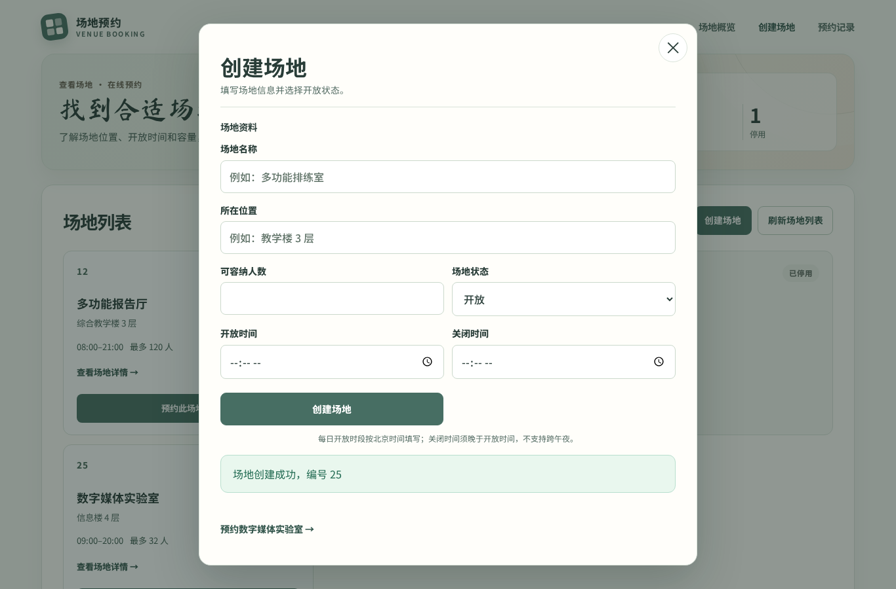
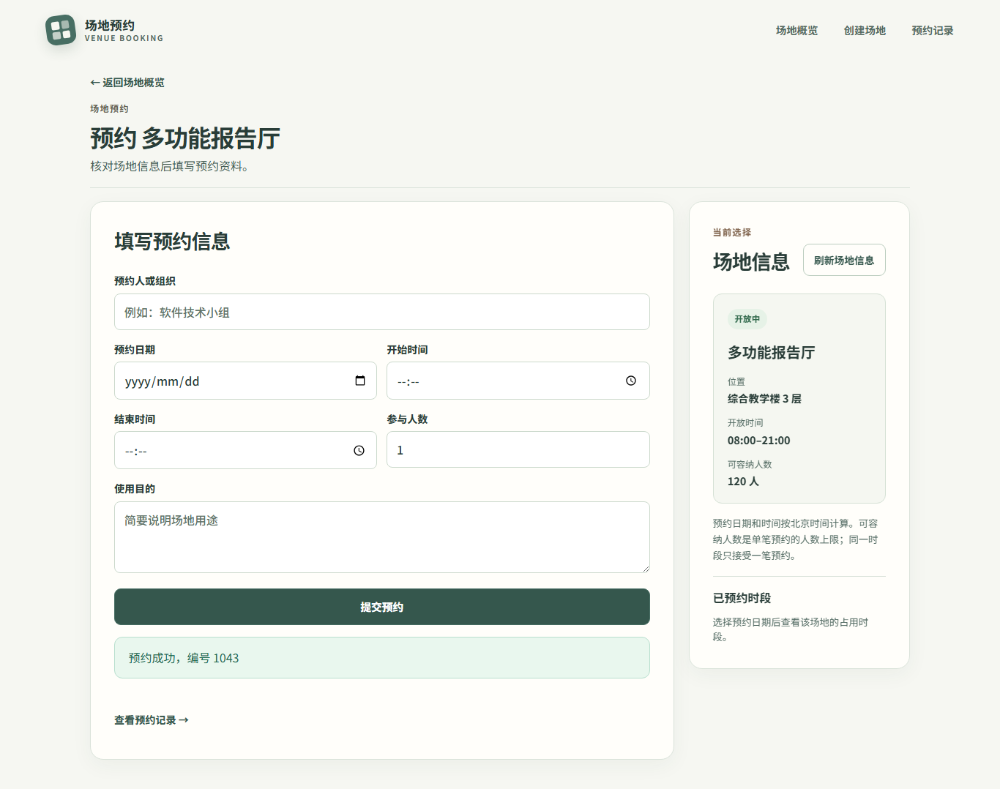
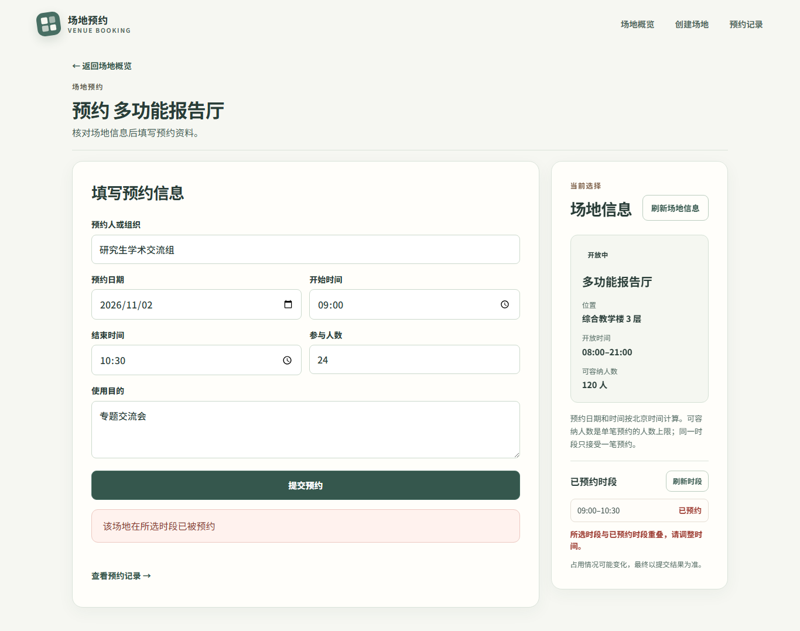
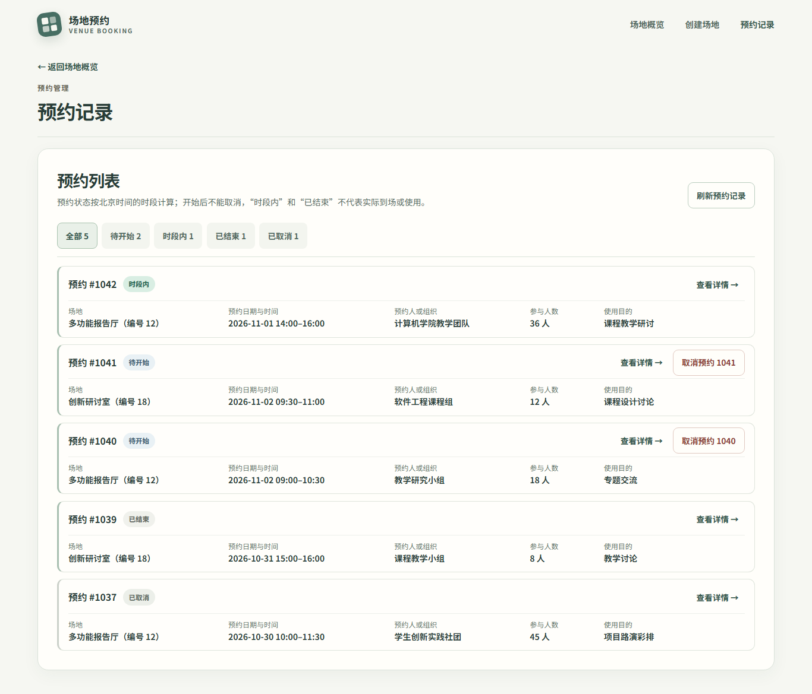
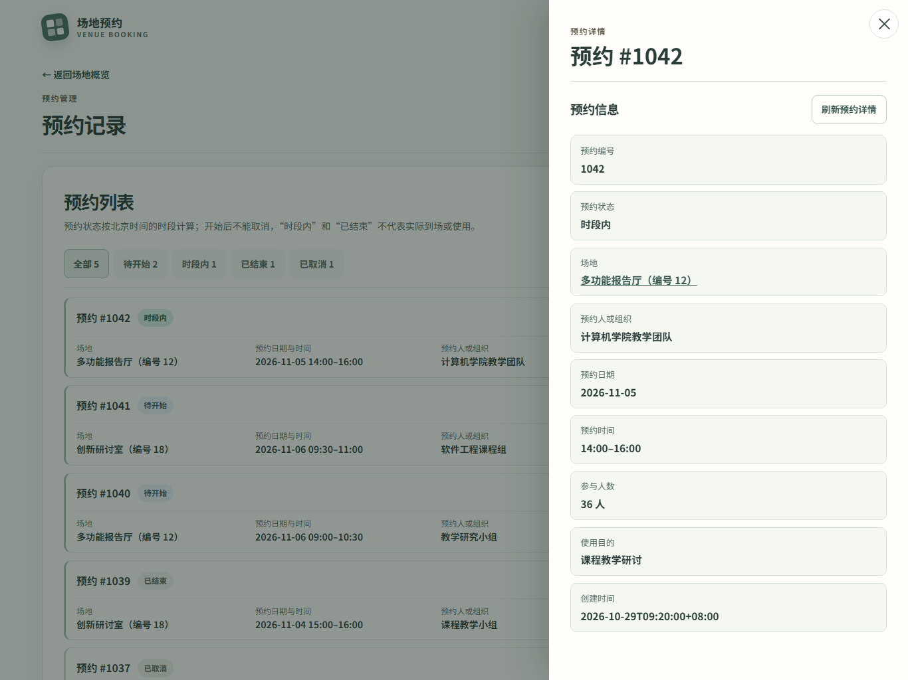
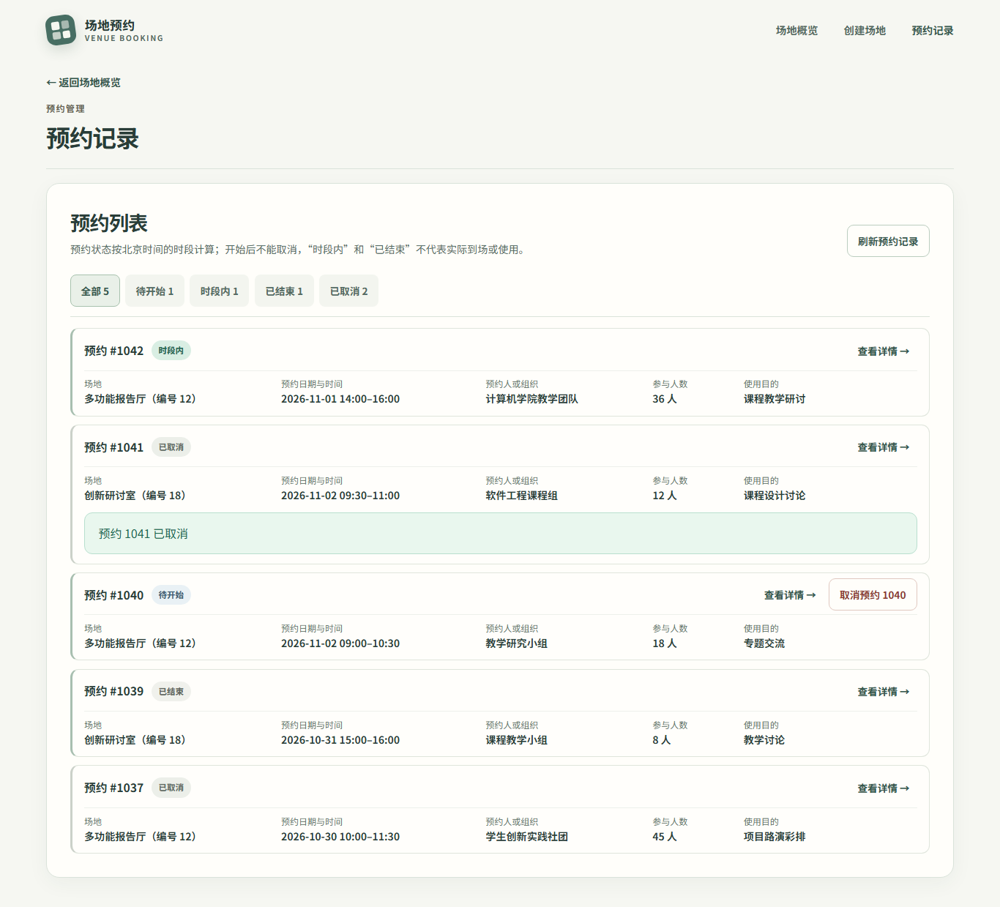

# 云原生软件技术 Lab 1 实验报告

## 项目运行方式

准备已启动的 Docker Engine（或 Docker Desktop）及支持 `docker compose` 命令的 Compose v2。在仓库根目录仅首次将 `.env.example` 复制为 `.env`，修改 `POSTGRES_PASSWORD`；`FRONTEND_PORT` 默认为 `8080`，可按需调整。然后执行：

```sh
docker compose config --quiet
docker compose up --build -d --wait --wait-timeout 180
docker compose ps
docker compose logs --tail=100 frontend api database
```

使用浏览器访问 `http://localhost:8080/`；如修改了 `FRONTEND_PORT`，则使用相应端口。结束运行时执行 `docker compose down`，保留数据库命名卷中的数据，不添加 `-v`。

## 1. 实验目标与系统架构

本实验完成可从源码重复构建的场地预约系统，并在 Docker Compose 中运行前端、Web API 和 PostgreSQL。浏览器经前端 Nginx 访问同源 `/api`；API 校验输入、场地状态与预约冲突，并将场地和预约保存到关系数据库。三个服务通过 Compose 网络通信，仅前端向宿主机发布端口。

| 服务 | 实现与职责 | 数据及配置 |
| --- | --- | --- |
| `frontend` | React 页面由 Nginx 提供，代理 `/api` 请求 | 只接收 HTTP JSON，不连接数据库 |
| `api` | Spring Boot 处理七个业务接口、事务与错误响应 | 从环境变量读取数据库连接；提供健康端点 |
| `database` | PostgreSQL 保存场地和预约 | Flyway 初始化与迁移；命名卷保留数据 |

用户可查询与创建场地、创建与查询预约，并取消预约；API 拒绝无效输入、停用场地及重叠时段。取消采用逻辑取消，原记录仍可查询；取消后同一时段可重新预约。前后端各有独立 Dockerfile，数据库使用官方镜像。接口、部署和验收结果见第 3、5–7 节。

## 2. 前端实现与用户交互

### 2.1 前端职责与技术结构

前端使用 React 19、TypeScript 7 和 Vite 8。`App.tsx` 管理场地、预约、表单草稿及操作反馈；`api/` 统一处理 HTTP 请求与响应校验；`validation/` 承担提交前的输入检查；`components/` 与 `pages/` 分别组织通用交互和业务视图。前端请求使用同源路径 `/api/...`。本地开发由 Vite 根据 `VITE_API_PROXY_TARGET` 转发请求，容器运行时由 Nginx 转发。

场地概览与预约记录是两个主视图。场地详情、预约详情和创建场地采用面板展示，并保留可直接访问和刷新的地址；预约表单使用独立页面，便于同时查看场地资料和提交反馈。详情面板支持键盘焦点管理与 `Esc` 关闭，关闭后返回原列表。预约记录将核心字段集中在条目中，减少逐条查阅时的页面滚动。

| 地址 | 功能 |
| --- | --- |
| `#/` | 查看场地列表、状态、位置、容量和开放时段 |
| `#/venues/new` | 创建开放或停用场地 |
| `#/venues/{id}` | 查询场地详情，并从开放场地进入预约 |
| `#/venues/{id}/book` | 查看选中场地并创建预约 |
| `#/reservations` | 查看、筛选和取消预约 |
| `#/reservations/{id}` | 查询预约详情与状态 |

### 2.2 用户功能与业务交互

#### 2.2.1 场地查询与创建

场地概览展示场地名称、编号、位置、容量、开放时段和状态。用户可打开详情面板查询完整信息；停用场地仍可查看，但不提供预约入口。创建场地时，用户填写名称、位置、容量、每日开放与关闭时间，并选择开放或停用状态。前端检查必填文本、字段长度、正整数容量和时间顺序。收到符合接口约定的 `201 Created` 响应后，页面显示新场地编号、清空表单并更新场地列表；创建失败时保留输入。

#### 2.2.2 预约创建

用户选择开放场地后，填写预约人或组织、日期、起止时间、参与人数和使用目的。前端检查日期是否有效、按北京时间计算的过去日期和当天时间、场地开放时段、人数上限、起止时间顺序，以及文本必填与长度限制。选择日期后，页面查询该场地的有效预约并显示已预约时段；若其覆盖整个开放时段，则提示当日已约满。所选时间重叠时给出提示，时段查询失败仍允许提交；API 对场地状态、输入和时间冲突作最终校验。仅在收到符合约定的 `201 Created` 响应后，页面显示服务器生成的预约编号并清空表单。

#### 2.2.3 预约查询与取消

预约列表展示“待开始”“时段内”“已结束”“已取消”四种互斥状态，条目包含场地名称与编号、日期与时间、预约人或组织、人数和用途。前三类按北京时间的预约时段计算，已取消状态优先；“时段内”和“已结束”只描述预定时间，不代表实际到场或使用。API 与数据库仍只保存 `ACTIVE/CANCELLED`。状态筛选、每页六条的分页均在浏览器中完成，不改变 API 返回的列表数据。预约详情通过独立接口查询，展示完整记录、当前展示状态及创建和取消时间。

仅“待开始”的预约提供取消操作，界面要求二次确认；选择“保留预约”不会发送取消请求。预约开始时及之后，服务端拒绝取消。确认后，前端依据 API 返回的 `CANCELLED` 状态更新记录。已取消记录仍可查询，但不再提供取消操作。重新进入预约记录页时会读取服务器数据；刷新失败时保留上次成功获取的记录，并明确提示其可能不是最新。

### 2.3 API 调用与异常反馈

前端调用第 3.2 节所列接口，按约定使用 `snake_case` JSON 字段。预约日期和日内时间分别发送为 `YYYY-MM-DD`、`HH:mm`；创建和取消时间采用 API 返回的带时区时间戳。浏览器原生日期、时间控件的显示格式不影响请求格式。

对参数错误、资源不存在和时间冲突，页面分别展示 API 的 `400`、`404`、`409` 响应所附的可读信息；字段校验详情会转换为对应的中文字段提示。服务端故障显示通用错误，不展示内部异常。网络中断或成功响应结构异常时，页面提示用户先刷新场地或预约列表核对结果，再决定是否重试，避免结果不确定时重复创建。提交期间禁用表单与重复操作。前端校验用于及时反馈，不能替代 API 的业务校验与并发冲突控制。

### 2.4 前端容器化实现

`frontend/Dockerfile` 采用两阶段构建。构建阶段基于 `node:24.15.0-alpine3.23`，使用锁定依赖执行 `npm ci`，再通过 `npm run build` 完成 TypeScript 检查和 Vite 构建。运行阶段基于 `nginx:1.28.2-alpine3.23`，只复制静态构建产物与 Nginx 配置，监听容器内 `80` 端口。`.dockerignore` 排除本地依赖、缓存、构建产物、Git 数据、日志和环境变量文件。

Nginx 提供静态页面，并将 `/api/` 请求代理至 Compose 网络中的 `http://api:8080`。配置使用原始请求 URI，保留 `/api` 前缀；`try_files $uri $uri/ /index.html` 为页面地址提供回退。浏览器始终使用同源 API 路径，前端构建产物无需写入后端容器地址。

### 2.5 前端自动验证

前端通过 Vitest 验证场地与预约操作、输入校验、错误反馈和时间边界，通过 Playwright/Chromium 验证页面布局和交互，并完成类型检查与生产构建。浏览器自动测试使用可控 HTTP 响应；真实部署的页面操作另见第 6.2 节。测试结果汇总见第 6.4 节。

## 3. 后端 API 与业务逻辑

### 3.1 技术结构与数据职责

后端使用 Java 17、Spring Boot 3.4.5、Spring Web、Jakarta Validation、Spring Data JPA 和 PostgreSQL 16。代码按 `Controller → DTO → Service → Repository → PostgreSQL` 分层：Controller 接收 HTTP 请求并返回状态码与 `Location`；DTO 定义公开的输入输出；Service 执行业务校验、事务和状态变更；Repository 查询和保存 JPA 实体。`GlobalExceptionHandler` 集中转换业务异常，Actuator 提供 `/actuator/health`。

公开 JSON 使用 UTF-8、`snake_case` 字段；`created_at`、`cancelled_at` 为带时区的 ISO 8601 时间戳。业务日期按 `Asia/Shanghai` 判断，数据库的 `TIME WITHOUT TIME ZONE` 保存本地钟点值，不做时区偏移换算。迁移与表结构见第 4 节。

### 3.2 API 设计

七个接口均以 `/api` 开头，列表直接返回数组；场地列表按 `id` 升序，预约列表按 `id` 降序且包含已取消记录。

| 方法与路径 | 用途 | 成功响应 | 主要错误 |
| --- | --- | --- | --- |
| `GET /api/venues` | 查询场地列表 | `200`，场地数组 | `500` |
| `GET /api/venues/{id}` | 查询场地详情 | `200`，场地对象 | `400` 无效 ID；`404` 场地不存在 |
| `POST /api/venues` | 创建场地 | `201`，场地对象；`Location: /api/venues/{id}` | `400` 输入无效 |
| `GET /api/reservations` | 查询预约列表 | `200`，预约数组 | `500` |
| `GET /api/reservations/{id}` | 查询预约详情 | `200`，预约对象 | `400` 无效 ID；`404` 预约不存在 |
| `POST /api/reservations` | 创建预约 | `201`，预约对象；`Location: /api/reservations/{id}` | `400` 输入或业务时间无效；`404` 场地不存在；`409` 场地停用或时段冲突 |
| `POST /api/reservations/{id}/cancel` | 开始前逻辑取消预约 | `200`，取消后的预约对象 | `400` 无效 ID；`404` 预约不存在；`409 CANCELLATION_CLOSED` 已开始 |

### 3.3 核心业务规则

- **场地状态与容量**：创建场地时校验名称、位置、正整数容量和开放时间顺序；省略 `status` 时默认为 `OPEN`。`CLOSED` 场地仍可查询，但不能接受预约。预约人数须满足 `1 ≤ attendee_count ≤ venue.capacity`。

- **日期与开放时段**：预约日期不能早于上海时区的当天；预约当天时，开始时间须晚于当前本地时间。每条预约须满足 `venue.open_time ≤ start_time < end_time ≤ venue.close_time`，只允许同一自然日内的时段。

- **时间冲突**：仅比较同一场地、同一日期的 `ACTIVE` 预约。预约区间采用半开形式 `[start_time, end_time)`；冲突条件为 `existing.start_time < request.end_time && existing.end_time > request.start_time`。因此 `10:00–11:00` 与 `11:00–12:00` 相邻可预约，实际重叠则返回 `409 TIME_CONFLICT`。

- **逻辑取消**：仅预约开始前可取消；到达开始时刻后取消尚未取消的预约，返回 `409 CANCELLATION_CLOSED`。取消保留原记录，将 `status` 改为 `CANCELLED` 并写入 `cancelled_at`。重复取消返回同一已取消记录和原取消时间，保持幂等；已取消记录不占用时段，同一时段可以重新预约。

### 3.4 并发控制

创建预约在同一个 `@Transactional` 事务内执行：通过 `PESSIMISTIC_WRITE` 锁定目标 `venue` 行 → 校验场地与请求 → 查询冲突的 `ACTIVE` 预约 → 无冲突才插入并提交。PostgreSQL 使用默认 `READ COMMITTED` 隔离级别。同一场地的并发请求在场地行锁处排队；先提交的预约会进入后一个请求的冲突查询，因此不能都成功。取消时也先锁场地，再锁预约并更新状态，保持一致的加锁顺序。

并发集成测试通过真实 PostgreSQL 验证相同时段只能创建一条有效预约，取消后同一时段可以重订；结果见第 6.4 节。

### 3.5 统一错误响应

后端通过统一异常处理返回稳定的错误结构，不向客户端暴露堆栈、SQL 或环境变量。例如时间冲突返回：

```json
{
  "error": {
    "code": "TIME_CONFLICT",
    "message": "该场地在所选时段已被预约"
  }
}
```

`400 VALIDATION_ERROR` 处理无效 JSON、字段、容量和日期时间，可附字段级 `details`；`404 VENUE_NOT_FOUND` 与 `404 RESERVATION_NOT_FOUND` 处理不存在的资源；`409 VENUE_CLOSED` 与 `409 TIME_CONFLICT` 处理场地停用和时段冲突；`409 CANCELLATION_CLOSED` 处理已到开始时刻的未取消预约；意外故障返回 `500 INTERNAL_ERROR`。已取消预约的重复取消仍返回 `200` 和原取消时间，即使此时已过开始时刻。

### 3.6 容器化与验证

`api/Dockerfile` 使用 Maven/JDK 17 构建阶段从源码下载依赖并打包，再用 JRE 17 运行阶段只携带应用 jar，以非 root 用户在容器内监听 `8080`。数据库连接由 `SPRING_DATASOURCE_URL`、`SPRING_DATASOURCE_USERNAME`、`SPRING_DATASOURCE_PASSWORD` 注入；Compose 中 JDBC 地址使用 `database:5432`，镜像内不写入密码。`/actuator/health` 可报告应用和数据库健康状态。

后端集成测试使用 PostgreSQL Testcontainers，覆盖接口响应、预约边界、并发冲突和 V2 数据升级至 V3；通过结果见第 6.4 节。三服务部署结果见第 6.1 节。

## 4. 数据库设计

### 4.1 数据模型与字段

数据库使用 PostgreSQL 16，业务表为 `venues` 与 `reservations`。一个场地对应多条预约，`reservations.venue_id` 是引用 `venues(id)` 的非空外键；两表主键均为数据库生成的 `BIGINT` identity。种子插入不指定 ID，后续 API 写入继续使用数据库序列。

| 表 | 关键字段与存储方式 |
| --- | --- |
| `venues` | `name VARCHAR(100)`、`location VARCHAR(200)`、`capacity INTEGER`、`open_time/close_time TIME WITHOUT TIME ZONE`、`status VARCHAR(10)` |
| `reservations` | `venue_id BIGINT`、`booked_by VARCHAR(100)`、`reservation_date DATE`、`start_time/end_time TIME WITHOUT TIME ZONE`、`attendee_count INTEGER`、`purpose VARCHAR(500)`、`status VARCHAR(10)`、`created_at/cancelled_at TIMESTAMP WITH TIME ZONE` |

业务日期和日内钟点按 `Asia/Shanghai` 解释；创建与取消时间保存实际时间点。取消不删除行，`CANCELLED` 记录继续关联原场地，便于查询历史。外键没有级联删除配置。

### 4.2 数据库约束与索引

除 `cancelled_at` 外，业务列均要求非空；四个必填文本字段不能仅含空白或不可见字符，长度由 `VARCHAR` 上限约束。`capacity`、`attendee_count` 必须大于 0；开放时间、预约起止时间分别满足前者小于后者。场地状态仅允许 `OPEN/CLOSED`，预约状态仅允许 `ACTIVE/CANCELLED`；`ACTIVE` 必须没有取消时间，`CANCELLED` 必须有取消时间。场地和预约默认状态分别为 `OPEN`、`ACTIVE`，创建时间默认 `CURRENT_TIMESTAMP`。

联合索引 `idx_reservations_conflict` 按 `(venue_id, reservation_date, status, start_time, end_time)` 建立，辅助有效预约的冲突查询。索引本身不阻止时段重叠；容量上限、开放时段、过去时间和并发冲突由后端 Service 及事务锁处理，见第 3 节。

### 4.3 Flyway 管理与独立验证

迁移位于 `api/src/main/resources/db/migration/`：V1 创建两张表、14 项命名约束及冲突索引；V2 插入两个开放场地和一个停用场地，不预置预约；V3 保留原约束名，更新四个文本非空白检查。Flyway 是结构唯一来源，由 API 启动时执行，JPA 使用 `ddl-auto=validate`。不另用数据库初始化目录或 JPA 自动建表；已执行迁移不回改，结构变化新增版本。

独立数据库脚本验证空库迁移、重复迁移、文本和数值约束、合法边界、identity、默认值、逻辑取消及外键保护。已有数据若违反 V3 新约束，须在迁移前修正，V3 不会自动改写。验证结果见第 6.4 节。

## 5. Docker 与 Compose 配置

### 5.1 三服务编排

前后端 Dockerfile 的构建与运行阶段见第 2.4、3.6 节。根目录 `compose.yaml` 编排三个服务；数据库使用 `postgres:16.15-bookworm` 官方镜像。

```text
浏览器 → 宿主机 8080 → frontend:80
                         │ /api/*，保留原路径
                         ▼
                       api:8080
                         │ JDBC
                         ▼
                     database:5432
                         │
                     postgres_data
```

| 服务 | 构建或镜像 | 端口与职责 |
| --- | --- | --- |
| `frontend` | `./frontend` → `venue-booking-frontend:lab1` | 容器内 80；映射 `${FRONTEND_PORT:-8080}:80` |
| `api` | `./api` → `venue-booking-api:lab1` | 容器内 8080；不发布宿主机端口 |
| `database` | `postgres:16.15-bookworm` | 容器内 5432；不发布宿主机端口 |

三个服务使用 Compose 默认网络，通过服务名互相访问。API 等待数据库 `service_healthy` 后启动，前端等待 API 的 `/actuator/health` 通过后启动。数据库 healthcheck 使用 `pg_isready` 经本地 TCP 检查，间隔 5 秒、超时 5 秒、启动宽限 10 秒、重试 12 次。API 健康检查通过 HTTP 确认应用及数据库连接均可用。

### 5.2 配置外部化与命名卷

根目录 `.env.example` 提供四个变量：`POSTGRES_DB`、`POSTGRES_USER`、`POSTGRES_PASSWORD`、`FRONTEND_PORT`。真实 `.env` 仅保存在本机，被 Git 忽略。数据库凭据通过环境变量传入容器，不写入镜像。

Compose 显式向数据库传入三个 `POSTGRES_*` 变量，向 API 注入 `SPRING_DATASOURCE_URL/USERNAME/PASSWORD`。JDBC URL 为 `jdbc:postgresql://database:5432/${POSTGRES_DB}`；Compose 读取 `.env` 只用于变量替换，不意味着容器自动获得文件内全部变量。三个数据库变量为空时，配置解析直接失败。

`postgres_data` 命名卷挂载到 `/var/lib/postgresql/data`。实际卷名以 Compose 项目名为前缀；执行 `docker compose down` 后卷仍保留。healthcheck 中的 `$$POSTGRES_USER`、`$$POSTGRES_DB` 留到容器内展开。数据库接受连接的检查之外，另由 Actuator 验证 API 到数据库的连接。

## 6. 系统部署与功能验收

### 6.1 整体启动与状态

按开头的命令从源码构建并启动三服务。容器状态、HTTP 请求、Actuator 和启动日志的结果如下。

| 核对项 | 结果 |
| --- | --- |
| 容器与端口 | `frontend`、`api`、`database` 均运行；仅前端发布宿主机端口 |
| 服务健康 | API、数据库均为 `healthy`；Actuator 应用及数据库状态均为 `UP` |
| 前端入口与代理 | 首页及经 Nginx 转发的 `/api/venues` 均返回 `200` |
| 迁移与启动日志 | 空库应用 V1–V3，JPA 校验后正常启动；重建时 Flyway 校验 3 个迁移并确认结构已是 V3，日志未见持续重复的严重错误 |

### 6.2 功能联调

实际页面使用流程为：打开首页并查询场地，创建场地和预约后查询详情；对同一时段再次提交时，API 返回 `409 TIME_CONFLICT`；取消原预约后，该时段可以重新预约。Chrome 页面操作还核对了预约状态、取消入口和整日约满提示。页面请求经 Nginx 连接真实 API 与 PostgreSQL，详细结果见[最终验收记录](assets/lab1-report/finalize-acceptance.json)。

### 6.3 界面示例与用例展示

以下为界面示例截图；实际验收结果见第 6.4 节。



图 1：场地概览展示位置、容量、开放时段与状态，停用场地没有预约入口。



图 2：场地详情面板展示场地编号和完整基本信息。



图 3：创建场地成功后显示新场地编号及后续预约入口。



图 4：预约成功后显示预约编号，并提供查看预约记录的入口。



图 5：时间冲突时保留表单输入，显示已预约时段和后端返回的失败信息。



图 6：预约列表按待开始、时段内、已结束和已取消分类，并支持筛选。



图 7：预约详情展示场地、预约人、时段、当前展示状态与创建时间。



图 8：取消成功后记录保留，状态更新为“已取消”。

### 6.4 验收结果汇总

| 验收项 | 结果 | 依据 |
| --- | --- | --- |
| 前端自动验证 | 136 项单元测试、8 项浏览器测试及生产构建通过 | 第 2.5 节；浏览器套件使用可控 HTTP 响应 |
| 后端集成验证 | 13 项真实 PostgreSQL 测试通过，无失败、错误或跳过 | 第 3.6 节 |
| 数据库迁移与约束 | V1–V3、`validate`、重复 `migrate` 通过；29 组非法写入被拒绝 | 第 4.3 节 |
| 真实链路检查 | 28 项通过，覆盖七个接口、相对 `Location`、输入拒绝、冲突与相邻时段、并发操作及取消边界 | 第 6.2 节 |
| 真实页面操作 | 13 项通过，覆盖预约、冲突、取消、重订、状态和约满提示 | 第 6.2 节 |
| 容器重建与持久化 | 10 项对比通过，完整数据库记录及 API 响应一致 | 第 7 节 |

### 6.5 自动验证复现

复现自动测试需 Node.js 24.15.0 或满足 `frontend/package.json` 的版本、Java 17、Maven 和已启动的 Docker Engine。前端在 `frontend/` 中执行：

```sh
npm ci
npm test
npm run build
npx playwright install chromium
npm run test:layout
```

后端在 `api/` 中执行 `mvn test`；数据库约束在仓库根目录执行 `python3 scripts/verify-database.py` 验证。Testcontainers 和数据库验证脚本均需连接 Docker Engine。

## 7. 容器重建与数据持久化验证

持久化验证包含一条已取消预约及其同一时段的重订记录。保存重建前的数据库记录、API 响应和命名卷信息后，使用相同 Compose 项目执行：

```sh
docker compose down
docker compose up -d --wait --wait-timeout 180
```

重建不使用 `-v`，以复用原命名卷。重建前后 10 项对比检查全部通过：

| 对比项 | 重建前 | 重建后 |
| --- | --- | --- |
| 预约记录 | 已取消与重订记录均存在 | 状态、时间及其他字段均一致；页面刷新后仍可查询 |
| 数据与 API | 场地 6 条、预约 10 条；SQL 与列表响应快照已记录 | 数量及完整记录逐字段一致 |
| Flyway 历史 | V1–V3 成功，校验和已记录 | 历史一致，无需重复迁移 |
| 容器与命名卷 | 容器、镜像 ID 及 `postgres_data` 卷已记录 | 三个容器 ID 均变化，镜像 ID 均未变；继续使用同一卷 |

重建后 API 与数据库健康状态仍为 `UP`。完整快照和检查结果见[持久化对比记录](assets/lab1-report/finalize-persistence.json)。

## 8. 小组分工

| 成员 | 实际交付 |
| --- | --- |
| 李佳凝 | 前端页面与交互、表单校验、API 对接、前端自动化测试、前端镜像及 Nginx；修复创建响应、并发取消、V3 文本约束与 Compose 启动就绪，整理实验报告与截图。 |
| 张玳瑗 | Spring Boot 接口、JPA 数据模型、预约冲突与取消事务、参数校验、统一错误处理、后端容器及 PostgreSQL 集成测试；修复日内时间偏移问题。 |
| 吴柯蝶 | 数据库 V1/V2 迁移、种子数据、独立验证脚本、Compose 编排与环境变量模板；完成三服务联调、真实页面验收、容器重建持久化验证，补充部署与验收证据。 |

## 9. 关键问题与解决

### 9.1 日内时间偏移

PostgreSQL 的 `TIME WITHOUT TIME ZONE` 保存日内钟点。Hibernate JDBC 时区设置与 UTC 容器时区叠加曾造成 API 与数据库的钟点相差 8 小时；移除该设置后，集成测试核对了种子数据及新建记录的时间一致性。业务日期仍按 `Asia/Shanghai` 判断。

### 9.2 并发预约与重复取消

单独查询冲突无法阻止并发请求同时通过校验，因此创建与取消预约均先锁定场地行。相同时段的并发创建结果为一个 `201`、一个 `409 TIME_CONFLICT`；八次并发取消保留同一取消时间。具体加锁顺序见第 3.4 节。

### 9.3 创建响应与文本校验

创建接口改用 `/api/...` 相对 `Location`，避免代理转发时依赖宿主机地址。API 与 Flyway V3 对四个必填文本字段统一校验空白及不可见字符，NUL 输入返回 `400 VALIDATION_ERROR`。前端的 `trim()` 预检不能识别全部零宽字符，此类输入由 API 拒绝，数据库约束也会拒绝直接写入。

## 10. 实验总结

系统贯通场地与预约的查询、创建、取消和冲突拒绝：前端展示占用时段与约满状态，后端以事务锁控制并发，数据库约束拦截非法数据。三服务可通过 Compose 从源码构建，外部配置、健康检查和命名卷支持部署复现与数据保留；自动测试、真实页面操作及容器重建验证了核心流程。
