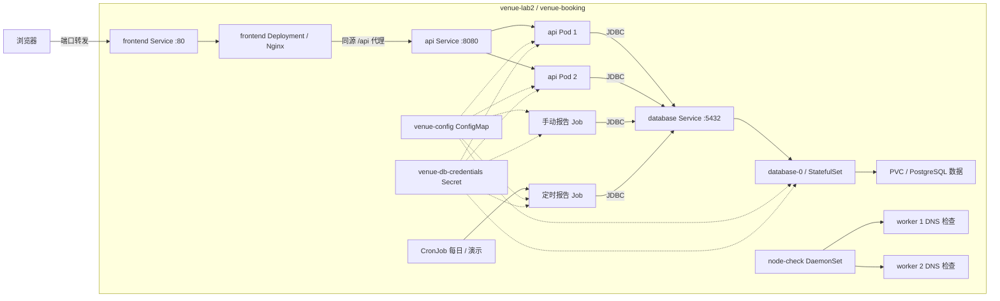
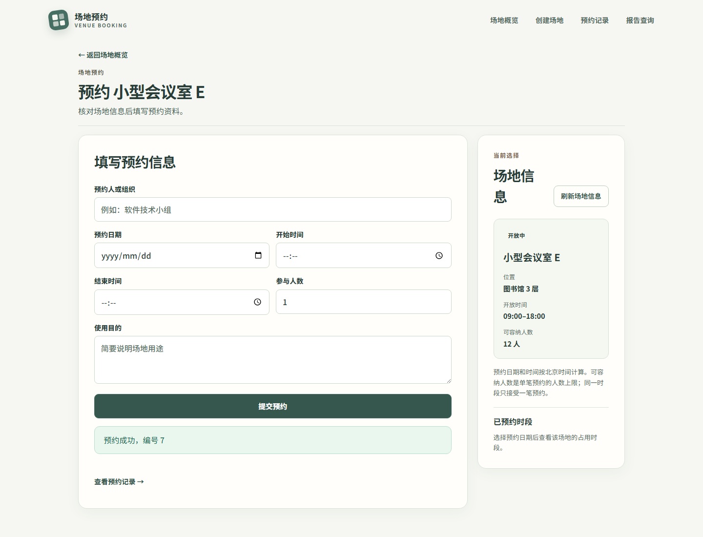
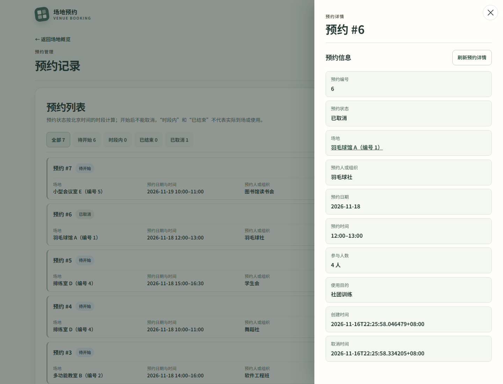
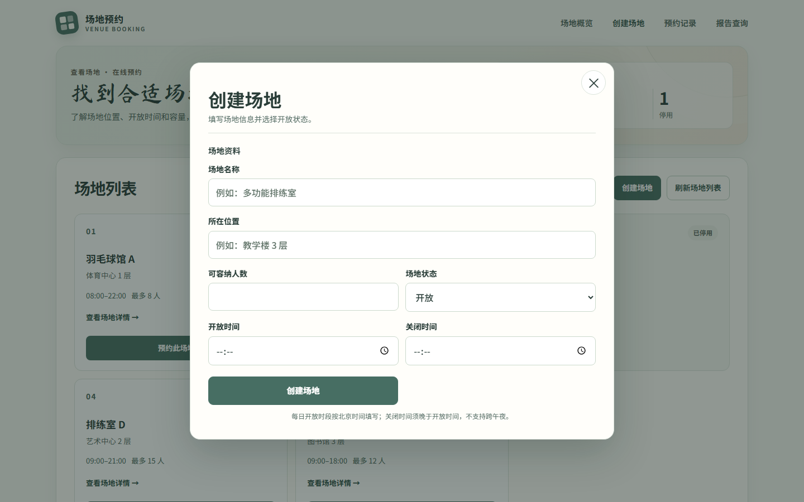
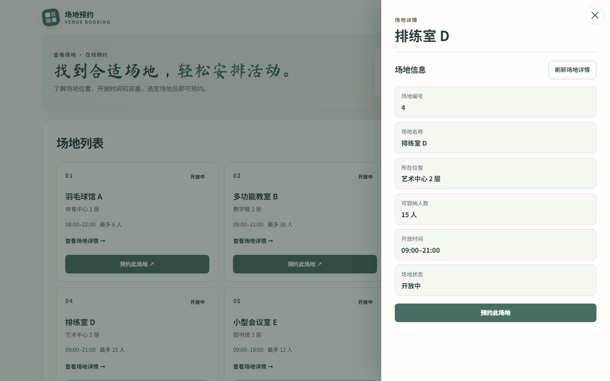

# 云原生软件技术 Lab 2 实验报告

## 1. 实验目标与系统概况

本实验将 Lab 1 的场地预约系统部署到 Kubernetes，保留场地管理、预约、冲突检查与取消等业务功能。在此基础上，新增预约统计报告和节点 DNS 检查任务，实践 Job、CronJob 与 DaemonSet。

本组采用 kind 集群。前端与 API 使用 Deployment，数据库使用 StatefulSet；报告任务和节点检查分别采用 Job、CronJob 与 DaemonSet。集群验证表明，前端业务与报告查询可用，CronJob 连续两次自动生成报告，DaemonSet 在两个可调度 worker 上均完成 DNS 检查。前端、CronJob 与 DaemonSet 已达到实验要求中的对应项目。

本组方案将一次性与定时报告统一为可按 Job ID 查询的持久化结果，并在页面呈现非零和零值统计；前端通过集群内 Service 访问 API，节点检查的脚本与就绪探针使用同一 DNS 目标，使页面、任务结果与资源状态便于核对。

### 1.1 Kubernetes 环境、版本、节点与镜像方式（C）

### 1.2 系统架构图与组件通信路径（A、B、C）



图示为已验收的 `venue-booking` 工作负载和访问路径：两个 API Pod 与手动/定时 Job 通过数据库 Service 读写同一 PostgreSQL；Job/CronJob 共用 API 镜像，但报告 Pod 不提供 HTTP Service。节点检查独立运行在两个可调度 worker。`venue-booking-final` 是用于最终展示的独立命名空间，仍需 C 部署复测，不能把上图的历史实测直接移作其验收结果。图与最终提交版由 A、B、C 共同复核。

### 1.3 系统运行与访问方式

系统的常规资源部署在 kind 集群 `venue-lab2` 的 `venue-booking` 命名空间。资源就绪后，在承载集群的主机上执行：

```sh
kubectl --context kind-venue-lab2 -n venue-booking port-forward service/frontend 8080:80
```

随后从该主机的浏览器访问 `http://127.0.0.1:8080/`。前端经 `api` Service 调用业务接口；API 和报告任务通过 `database` Service 访问数据库，内部服务无需直接对外开放。

场地与预约操作在前端完成。一次性报告通过 `scripts/create-report-job.py` 创建 Kubernetes Job，定时报告由 CronJob 自动生成；报告保存后，可在 `#/reports` 页面输入 Job ID 查询。DaemonSet 则在符合调度条件的节点持续执行 DNS 检查。

图 1—4 来自 `venue-booking-demo`，图 5—6 来自 `venue-booking-final`，均展示可读场地数据。常规命名空间 `venue-booking` 的运行记录列于附录 A；各组结果分别对应其所在命名空间。

## 2. Kubernetes 资源设计与系统实现

本章按组件的依赖关系，说明资源选择、访问路径和任务配置。运行结果见第 3 章。

### 2.1 资源清单与选择依据

#### 2.1.1 数据库 StatefulSet、Service、ConfigMap、Secret 与 PVC（C）

#### 2.1.2 API Deployment、Service 与一次性 Job（B）

| 资源类型 | 资源名称 | 用途与选择理由 |
| --- | --- | --- |
| Deployment | `api` | 运行两个无状态 Spring Boot API Pod；数据库持久化预约和报告，多副本可共同处理请求。 |
| Service | `api` | ClusterIP，`8080 → 8080`；为前端 Nginx 提供稳定的内部访问名称。 |
| Job | `venue-report-manual-<唯一后缀>` | 按给定日期范围执行一次报告后退出；Job 名称同时作为持久化报告的 `job_id`，无需独立 Service。 |

API 与报告 Job 使用同一后端镜像，报告模式通过启动参数选择。报告表由 Flyway V4 迁移创建，不在 Job Pod 内保存结果。

#### 2.1.3 前端与周期、节点任务（A）

| 资源类型 | 资源名称 | 用途与选择理由 |
| --- | --- | --- |
| Deployment | `frontend` | 运行无状态前端与 Nginx 代理，持续提供页面服务。 |
| Service | `frontend` | 为浏览器访问提供稳定入口，端口转发至其 80 端口。 |
| ConfigMap | `frontend-nginx` | 保存集群内的 Nginx 代理配置，使 `/api/` 请求到达 API Service。 |
| CronJob | `venue-report-daily` | 定时执行报告程序；任务完成后退出，无须 Service。 |
| DaemonSet | `node-check` | 在每个可调度节点运行 DNS 检查 Pod，无须 Service。 |

前端和节点检查 Pod 均设置资源请求、上限和就绪探针；前端另设启动与存活探针。两者都不需要 Kubernetes API 凭据，因此关闭 ServiceAccount token 自动挂载。

浏览器通过 `frontend` Service 访问页面，Nginx 再将 `/api/` 请求转发至 `api` Service。组件之间使用稳定的 Service 名称；非敏感配置存于 ConfigMap，数据库凭据由 Secret 提供。

### 2.2 数据库、配置与 PVC 持久化（C）

### 2.3 后端 API、双副本与 Service（B）

`api` Deployment 设为两个副本，容器监听 8080；同名 ClusterIP Service 只选择 API Pod，不暴露数据库端口。浏览器的 `/api` 请求先经前端 Nginx，再由 `api` Service 转发。API 和 Job 使用 `venue-config` 中的 JDBC 地址连接 `database:5432`，用户名与密码由 `venue-db-credentials` Secret 注入，清单没有写入实际凭据或 Pod IP。

API Pod 的 `POD_NAME` 由 Downward API 提供；`GET /api/instance` 返回该标识，用于核对请求到达的副本。startup/liveness 与 readiness 分别访问 Actuator 的 `/actuator/health/liveness` 和 `/actuator/health/readiness`；数据库可用性另以真实业务 API 操作验证。每个 API Pod 请求 100m CPU、256Mi 内存，上限为 500m CPU、512Mi 内存，并关闭不需要的 ServiceAccount token 自动挂载。

数据库就绪后由 API 启动执行 Flyway V1–V4；JPA 使用 `ddl-auto=validate` 检查映射，不另行改写表结构。两个副本共享 PostgreSQL，预约创建在事务中先锁定场地行，再检查有效预约的半开时段重叠并写入；取消也按场地优先的锁顺序执行。这样同一场地时段的并发请求由数据库串行化检查，而不是依赖请求落在哪个 Pod。

### 2.4 前端与报告查询页面（A）

前端保留场地与预约页面，并新增 `#/reports` 查询入口。用户输入 Job ID 后，页面调用 `GET /api/reports/{job_id}`，显示任务状态、统计范围、执行时间及各场地的预约次数和分钟数。零预约场地仍显示为零值。页面只读取已保存的报告，不创建 Job，也不直接访问 Kubernetes API。

| 查询情况 | 页面反馈 |
| --- | --- |
| `RUNNING` | 显示运行中和刷新入口；长时间未更新时提示核对 Job，不自行推断任务结束。 |
| `SUCCEEDED` | 显示报告元数据和全部场地明细，包括零值行。 |
| `FAILED` | 显示错误摘要，并提示 Job 可能继续重试。 |
| 报告不存在、网络中断或响应结构无效 | 分别显示对应提示，避免把查询失败解释为任务失败。 |

页面校验 Job ID，并避免旧请求覆盖新查询结果。运行中、失败及请求异常由前端测试覆盖；集群中另验证了成功报告的实际查询。

Kubernetes 专用 Nginx 配置由 ConfigMap 提供，代理目标为 `api` Service。浏览器通过前端 Service 的端口转发访问系统；API 与数据库无需直接对外开放。

### 2.5 一次性报告 Job（B）

`scripts/create-report-job.py` 根据起止日期和当前 API 镜像生成唯一名称的手动 Job。Job 容器沿用 `java -jar /app/app.jar` 入口，附加 `--spring.main.web-application-type=none`、`--report.run=true`，不启动 HTTP 服务。Pod 标签 `batch.kubernetes.io/job-name` 经 Downward API 注入为 `REPORT_JOB_ID`，另传 `REPORT_SOURCE=MANUAL`、`REPORT_START_DATE` 和 `REPORT_END_DATE`；成功退出码为 0，失败为非零。模板配置 `parallelism=1`、`completions=1`、`backoffLimit=1`、`activeDeadlineSeconds=1800`，关闭 ServiceAccount token 自动挂载。

Flyway V4 新增 `report_runs` 和 `report_items`。每个 `job_id` 对应一条运行记录，每个 `(job_id, venue_id)` 对应一条明细；数据库约束限制状态、来源、日期范围和非负统计值。统计对每个场地都生成一行，只计报告生成时状态为 `ACTIVE` 的预约，以结束时间减开始时间得到 `reserved_minutes`。这一字段表示已预约分钟数，不表示实际到场时长或百分比。

执行程序先持久化 `RUNNING`，再用单条 PostgreSQL 聚合查询取得一致快照，最后在一个事务中写入全部明细与 `SUCCEEDED`。同一 ID 已成功时直接沿用原快照；失败或残留 `RUNNING` 可按同来源和日期范围重试。数据库唯一约束、行锁和 Job 参数共同防止同 ID 的并发执行产生重复明细。可捕获的生成异常会保存脱敏的 `FAILED` 摘要；若进程在写入记录前终止，需结合 Kubernetes Job 状态和日志判断，不能由报告查询接口推断失败。

### 2.6 定时报告 CronJob（A）

`venue-report-daily` 使用与一次性 Job 相同的报告程序。正式配置每日 00:10 统计前一日；短周期配置每 2 分钟统计当天，便于观察自动触发。两种配置只改变调度周期与统计窗口。

| 配置 | 正式模式 | 演示模式 |
| --- | --- | --- |
| `schedule` | `10 0 * * *` | `*/2 * * * *` |
| `timeZone` | `Asia/Shanghai` | `Asia/Shanghai` |
| `REPORT_WINDOW_MODE` | `PREVIOUS_DAY` | `TODAY` |
| `REPORT_SOURCE` | `SCHEDULED` | `SCHEDULED` |

每次触发生成独立 Job，其名称同时作为报告标识。`Forbid` 防止同一 CronJob 的任务重叠；补启动期限、重试次数和执行时长均受到限制。

CronJob Pod 通过 `database` Service 读取预约数据，结果由报告程序持久保存。`Forbid` 只约束同一 CronJob 的并行执行；同一报告任务的重复执行由报告程序处理。

### 2.7 节点 DNS 检查 DaemonSet（A）

`node-check` 采用 DaemonSet，使每个符合调度条件的节点运行一个检查 Pod。脚本定期记录节点名称、宿主机地址和集群 DNS 解析结果；readiness 探针检查同一 DNS 名称，使就绪状态与任务结果一致。该任务无需 Service、特权容器或宿主机目录挂载。

集群中的两个 worker 可调度，control-plane 带 `NoSchedule` 污点。因此本实验的节点覆盖范围为两个 worker。

## 3. 系统使用与实验结果

本章展示业务操作和各类工作负载的运行结果。对应的命令输出与数据记录列于附录。

### 3.1 命名空间资源总览与配置核对（C）

### 3.2 场地与预约业务流程（A）

用户可按“浏览或创建场地 → 创建预约 → 查询记录 → 取消预约”的顺序完成业务操作。集群中的浏览器回归覆盖了这一流程，也验证了重复预约同一时段时的冲突反馈。页面请求经前端 Service 到达真实 API。

图 1 展示场地概览；图 2、3 对应同一场地时段的成功预约与再次提交时的冲突反馈；图 4 展示另一笔预约取消后的详情。画面用于说明交互方式；业务回归的原始结果见附录。创建表单、场地详情及预约列表等补充画面见附录 D。

<figure>
  
  <figcaption>图 1 场地概览与各场地的状态、位置、开放时段和容量。</figcaption>
</figure>

取消后的预约保留状态和取消时间，便于追溯。

<figure>
  
  <figcaption>图 2 预约创建成功，页面返回预约编号。</figcaption>
</figure>

<figure>
  
  <figcaption>图 3 重复提交已占用时段时，页面显示预约冲突和对应时段。</figcaption>
</figure>

<figure>
  
  <figcaption>图 4 已取消预约的状态与取消时间。</figcaption>
</figure>

### 3.3 API 双副本、Service 分流与并发预约（B）

在 `venue-booking` 共同集群中，两个 API Pod 均为 `1/1 Ready`，分别位于 `venue-lab2-worker` 和 `venue-lab2-worker2`。先前通过 `api` Service 建立独立连接，`GET /api/instance` 返回过两个不同 Pod 标识，证明同一 Service 能将请求交给两个副本；单个 Service 端口转发连接未被用作分流证据。

2026-11-19 的定向并发验收分别端口转发到两个 API Pod，两个 `/api/instance` 响应与 Pod 名称一一对应。C 创建唯一场地 ID `7`，对 `2026-12-19 10:00–11:00` 同时提交两份相同预约：一个返回 **201**、预约 ID `4`；另一个返回 **409 `TIME_CONFLICT`**。随后查询该场地仅有一条 `ACTIVE` 预约。此结果验证了两个副本同时访问同一数据库时的冲突保护；原始响应和 Pod 分布见附录 B。

### 3.4 数据库 Pod 重建与业务数据保留（C）

### 3.5 一次性报告 Job 的执行、持久化与失败重试（B）

首次手动 Job `venue-report-manual-20261116033534-9f4175` 在历史日期窗口完成，容器退出码为 0；API 返回 HTTP 200、`SUCCEEDED`，三个当时存在的场地均为零值。后来 A 在同一集群创建了有效与已取消预约。C 于 2026-11-19 使用新 Job `venue-report-manual-20261119102922-01fd83` 统计 `2026-11-16`，B 随后核对原始证据：Job 为 `Complete`、退出码 0，API 返回七条场地明细。场地 ID `4` 为 **1 次、30 分钟**，其余六条为零值；其中已取消预约不计入。报告的日期和统计值对应本次数据库状态，不将旧报告解释为随业务变化自动更新。

为验证幂等，C 保存该 Job 的状态、Pod 日志和完整报告响应，只删除**本轮新建**的 Job 及 Pod，再用相同 ID、来源、日期重建。删除后报告仍可通过 API 查询；重建 Job 再次 `Complete`、退出码 0，前后 JSON（含 `generated_at` 与全部明细）完全一致。只读 SQL 核对该 ID 在数据库中仍只有 1 条 `report_runs`、7 条 `report_items`。数据库 Pod 随后重建，报告响应保持一致；业务数据与 PVC 的前后原始记录见[交接回传](lab2-handoff.md)，由 C 在第 3.4 节归纳。

可捕获异常的 `FAILED →` 同 ID 重试由**隔离的 Testcontainers PostgreSQL 集成测试**验证：在聚合阶段注入异常后，运行记录变为 `FAILED`、错误摘要脱敏、明细为空；随后同 ID 重试成功。`ReportIntegrationTest` 六项全部通过，完整后端回归 21 项全部通过。共同集群没有注入该异常，因此本实验不声称观察到了集群中的 `FAILED` Job；参数错误或数据库不可达导致的非零退出也不冒充已落库的 `FAILED`。

### 3.6 报告查询页面（A）

报告查询页通过 Job ID 读取已持久化的结果。集群验证中，页面显示任务成功；有预约的场地为 **1 次、30 分钟**，无预约的场地为 **0 次、0 分钟**，与 API 返回值一致。已取消预约未计入统计。

图 5 展示另一份报告的查询结果。羽毛球馆 A 与排练室 D 均为 2 次、150 分钟，多功能教室 B 为 1 次、120 分钟；会议室 C 与小型会议室 E 均为零值。报告表示已预约时长，不代表实际到场时间或场地使用率。

运行中、失败和请求异常等页面反馈已由前端测试验证；这些状态不作为集群中的实际任务结果。

<figure>
  
  <figcaption>图 5 一次性报告的查询结果，显示不同场地的非零与零值统计。</figcaption>
</figure>

### 3.7 定时报告 CronJob 的自动执行（A）

短周期配置下，CronJob 连续自动创建了两个 Job。父资源记录表明两次执行均由 `venue-report-daily` 调度；报告来源均为 `SCHEDULED`，状态均为 `SUCCEEDED`。

| 自动执行 | 报告状态 | 有预约场地 | 零预约场地 |
| --- | --- | --- | --- |
| 第一次 | `SUCCEEDED` | 1 次、30 分钟 | 0 次、0 分钟 |
| 第二次 | `SUCCEEDED` | 1 次、30 分钟 | 0 次、0 分钟 |

两份报告均正确保留非零值和零值场地，且与数据库聚合结果一致。自动创建关系、报告结果与数据库聚合记录见附录 A。

图 6 展示另一组自动报告的页面查询结果：小型会议室 E 为 **1 次、60 分钟**，其余四个场地均为零值。

<figure>
  
  <figcaption>图 6 自动报告的查询结果，包含非零值和零值场地。</figcaption>
</figure>

正式配置采用北京时间每日 00:10 统计前一日，并已恢复到集群中。上述自动触发结果来自短周期配置；正式周期的跨日触发未纳入本次验证。

### 3.8 DaemonSet 的节点覆盖与检查结果（A）

`node-check` 在两个可调度 worker 上各运行一个 Pod，DaemonSet 的期望数与就绪数均为 **2**。两个 Pod 的 DNS 检查结果均为 `dns=ok`。

| 节点 | Pod 就绪 | DNS 检查 |
| --- | --- | --- |
| `venue-lab2-worker` | 1/1 | `dns=ok` |
| `venue-lab2-worker2` | 1/1 | `dns=ok` |

control-plane 带 `NoSchedule` 污点，不在本清单的覆盖范围内。因此“每节点一个 Pod”对应当前两个可调度 worker，而非集群中的全部节点。

## 4. 小组分工与问题解决

### 4.1 李佳凝：前端、CronJob 与 DaemonSet（A）

李佳凝负责前端与报告查询页面、前端 Deployment 和 Service、CronJob 及 DaemonSet。相应的运行结果见第 3 章。

节点检查最初出现“两个 Pod 已调度、均未就绪”的问题。脚本和就绪探针查询的短名称 `kubernetes.default.svc` 在两个 worker 上均返回 `NXDOMAIN`，而完整名称 `kubernetes.default.svc.cluster.local` 可以解析，故障由查询目标引起。

将脚本与就绪探针统一改为查询完整名称后，两个 Pod 均恢复就绪，日志均显示 `dns=ok`。修复前后的资源状态与日志保存在附录所列记录中。

### 4.2 张玳瑗：后端 API、一次性 Job 与并发问题（B）

张玳瑗负责沿用 Lab 1 的预约 API 与事务规则，新增 Flyway V4 报告表、统计程序、报告查询和实例标识接口，以及双副本 API 与手动 Job 清单。后端镜像同时供 API、手动 Job 和 CronJob 使用；与 A 对齐启动参数及报告 JSON，与 C 对齐迁移约束、Secret 引用和共同集群执行顺序。

多副本的关键问题是两个 Pod 可能同时接受同一时段预约。B 保留场地行悲观锁、有效预约重叠查询与插入同事务的处理；C 在不同 Pod 上同时提交请求后，实测只产生一条有效预约。报告任务的关键问题是 Job Pod 删除或重试不能丢失、复制或改写成功结果。B 将报告写入数据库，并用唯一键、行锁和同 ID 成功短路保护快照；C 的同 ID 重建与数据库 Pod 重建验收均保留了相同结果。可捕获失败的 `FAILED` 状态通过 B 的隔离集成测试验证，集群验收与本地测试在报告中分别标注。

### 4.3 吴柯蝶：集群、数据库与存储问题（C）

### 4.4 小组联合复核（A、B、C）

## 5. 项目总结

本实验将场地预约系统部署到 Kubernetes，按组件特征组合 Deployment、StatefulSet、Job、CronJob 和 DaemonSet。集群中的前端业务和报告查询可用；短周期 CronJob 连续两次生成成功报告，DaemonSet 在两个可调度 worker 上均通过 DNS 检查。正式 CronJob 的跨日触发未纳入本次验证。

## 附录：运行证据与补充界面

### A. 前端、CronJob 与 DaemonSet（A）

下表列出支撑第 3、4 章结论的关键原始记录。

| 验证环节 | 核实结果 | 原始记录 |
| --- | --- | --- |
| 前端业务 | 前端完成部署；场地、预约、冲突和取消的浏览器回归通过。 | [部署就绪](assets/lab2/a-execution-20261116-123004/frontend-rollout.txt)、[浏览器回归](assets/lab2/a-execution-20261116-123004/browser-cluster-regression.txt) |
| 报告查询 | 页面可查询手动与定时报告；非零值和零值与 API 结果一致。 | [三个 Job 的页面核对](assets/lab2/a-execution-20261116-123004/report-browser-checks.json)、[报告页面回归](assets/lab2/a-daemonset-retest-20261116-154006/report-f7-browser.txt)、[对应 API 响应](assets/lab2/a-daemonset-retest-20261116-154006/report-f7-api-response.json) |
| CronJob 自动执行 | 两个 Job 均由同一 CronJob 创建，报告成功且统计结果与数据库聚合一致。 | [Job 父资源](assets/lab2/a-execution-20261116-123004/cronjob-observed-jobs.json)、[首次报告](assets/lab2/a-execution-20261116-123004/venue-report-daily-29913392-report.json)、[第二次报告](assets/lab2/a-execution-20261116-123004/venue-report-daily-29913394-report.json)、[SQL 聚合](assets/lab2/a-execution-20261116-123004/today-sql-totals.txt) |
| CronJob 正式配置 | 配置为每日 00:10；跨日触发不在本次验证范围内。 | [验收配置](assets/lab2/a-execution-20261116-123004/cronjob-final-json.txt) |
| DaemonSet 节点检查 | 两个 worker 各有一个就绪 Pod，两份日志均为 `dns=ok`。 | [资源状态](assets/lab2/a-daemonset-retest-20261116-154006/daemonset-after.txt)、[Pod 分布](assets/lab2/a-daemonset-retest-20261116-154006/pod-distribution-wide.txt)、[两节点日志](assets/lab2/a-daemonset-retest-20261116-154006/combined-logs.txt) |
| DNS 问题定位 | 两个 worker 的短名称查询均失败，完整名称均可解析。 | [原日志：worker 1](assets/lab2/a-execution-20261116-123004/node-check-log-0.txt)、[原日志：worker 2](assets/lab2/a-execution-20261116-123004/node-check-log-1.txt)、[完整名称：worker 1](assets/lab2/a-execution-20261116-123004/node-check-fqdn-0.txt)、[完整名称：worker 2](assets/lab2/a-execution-20261116-123004/node-check-fqdn-1.txt) |

### B. 后端 API 与一次性 Job（B）

| 验证环节 | 核实结果 | 原始记录 |
| --- | --- | --- |
| API 两副本与 Service | 两个 Pod 分布在两个 worker；经 `api` Service 的独立连接出现两个实例标识。 | [Pod 分布](assets/lab2/b-execution-20261116-113439/api-pods-wide.txt)、[三次实例响应](assets/lab2/b-execution-20261116-113439/instance-0.txt)、[C 本轮 Pod 状态](assets/lab2/b-acceptance-20261119-182919/api-pods.txt) |
| Flyway 迁移 | 共同集群的 V1–V4 均成功。 | [迁移版本](assets/lab2/b-execution-20261116-113439/flyway-version.txt)、[API 启动日志](assets/lab2/b-execution-20261116-113439/api-startup-0.txt) |
| 双 Pod 并发预约 | 同场地同一时段得到 201 与 409 `TIME_CONFLICT`，仅保留一条有效预约。 | [两份响应与实例 ID](assets/lab2/b-acceptance-20261119-182919/01-concurrent-booking.txt)、[测试数据 ID](assets/lab2/b-acceptance-20261119-182919/business-ids.json) |
| 手动 Job 与报告查询 | 两次同名 Job 均完成，退出码均为 0；报告为 `SUCCEEDED`。 | [首次 Job/Pod](assets/lab2/b-acceptance-20261119-182919/report-first-job.json)、[重建 Job/Pod](assets/lab2/b-acceptance-20261119-182919/report-retry-pods.json)、[报告响应](assets/lab2/b-acceptance-20261119-182919/report-before.json) |
| 报告持久化与幂等 | 原 Job Pod 删除后仍可查询；同 ID 重试快照不变，数据库为 1 条运行记录、7 条明细。 | [删除后响应](assets/lab2/b-acceptance-20261119-182919/report-after-pod-delete.json)、[重试后响应](assets/lab2/b-acceptance-20261119-182919/report-after-retry.json)、[行数核对](assets/lab2/b-acceptance-20261119-182919/report-row-count.txt) |
| 可捕获失败与回归 | 隔离报告测试 6/6、完整后端回归 21/21；集群中未注入 `FAILED`。 | [报告测试原始输出（gzip）](assets/lab2/b-tests-20261119/report-integration-maven.txt.gz)、[完整回归原始输出（gzip）](assets/lab2/b-tests-20261119/backend-suite-maven.txt.gz) |

上述两份 gzip 文件解压后为未改写的 Maven 输出；可用 `gzip -dc <文件名>` 阅读。B/C 共同集群验收的执行时间、实际命令、退出码和更多状态记录见[交接记录](lab2-handoff.md)。

### C. 集群、数据库与存储（C）

### D. 业务页面补充图

以下画面补充展示表单、场地详情、已占用时段和预约列表。

<figure>
  
  <figcaption>图 7 创建场地表单包含名称、位置、容量和开放时段等输入项。</figcaption>
</figure>

<figure>
  
  <figcaption>图 8 排练室 D 的场地详情与预约入口。</figcaption>
</figure>

<figure>
  
  <figcaption>图 9 羽毛球馆 A 的预约表单显示两个已占用时段。</figcaption>
</figure>

<figure>
  
  <figcaption>图 10 预约记录列表展示状态筛选、记录内容与分页。</figcaption>
</figure>
