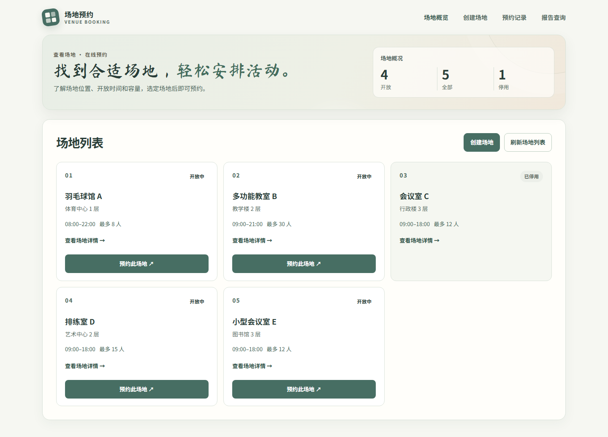
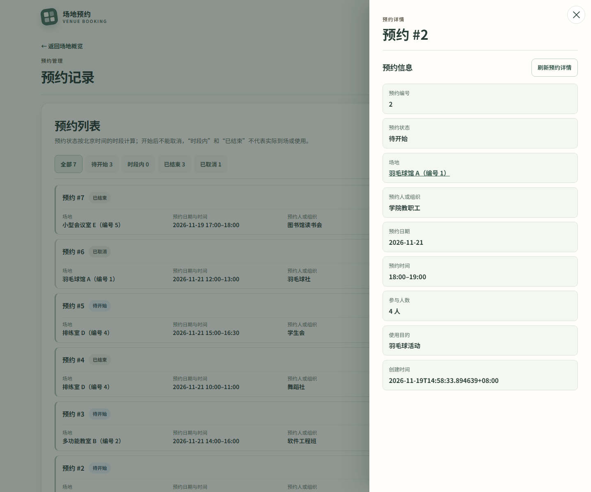
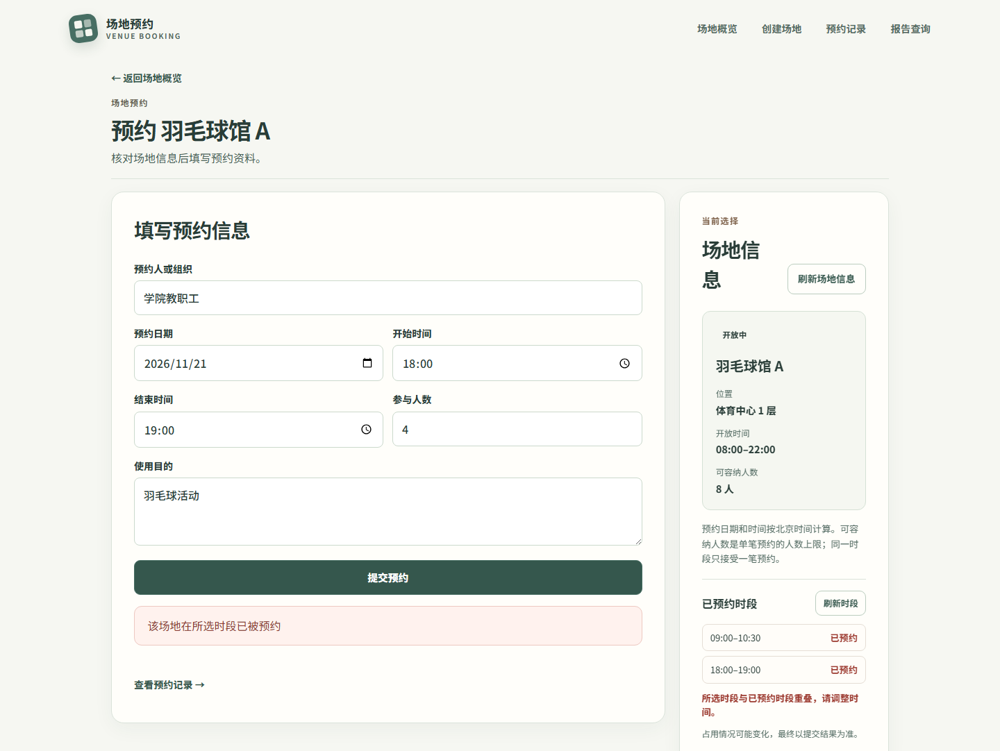
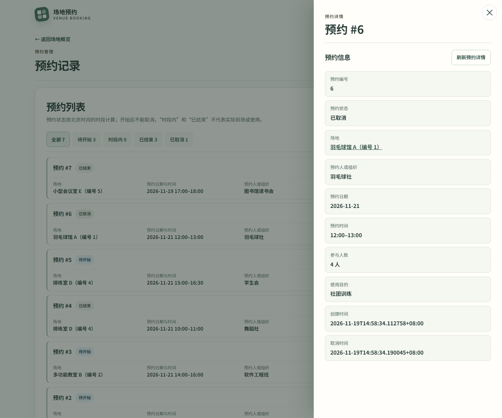
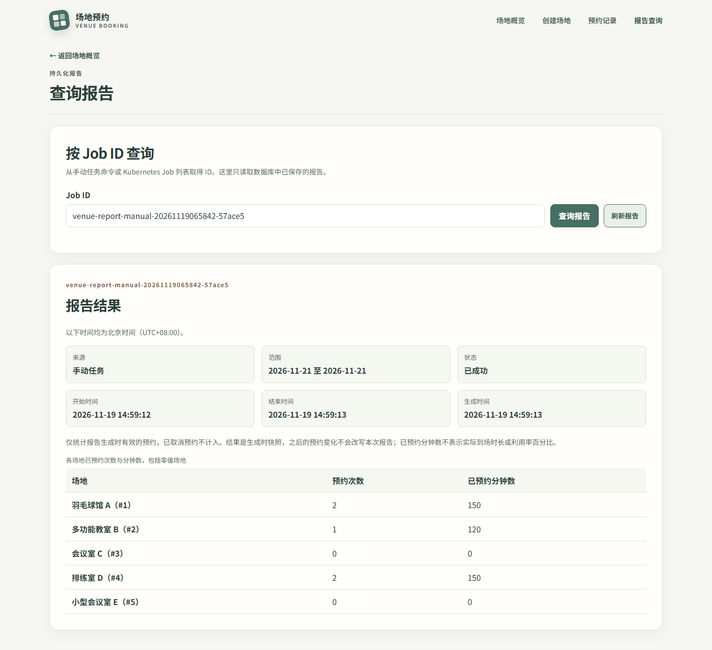
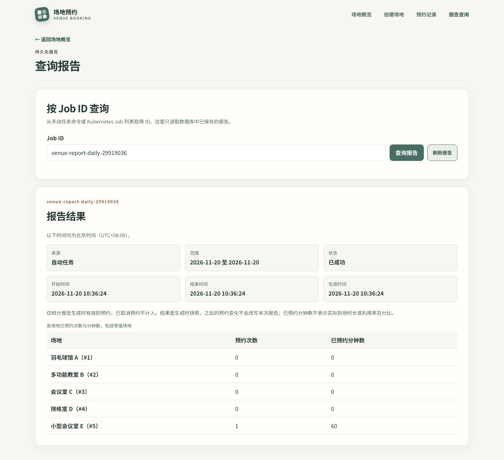
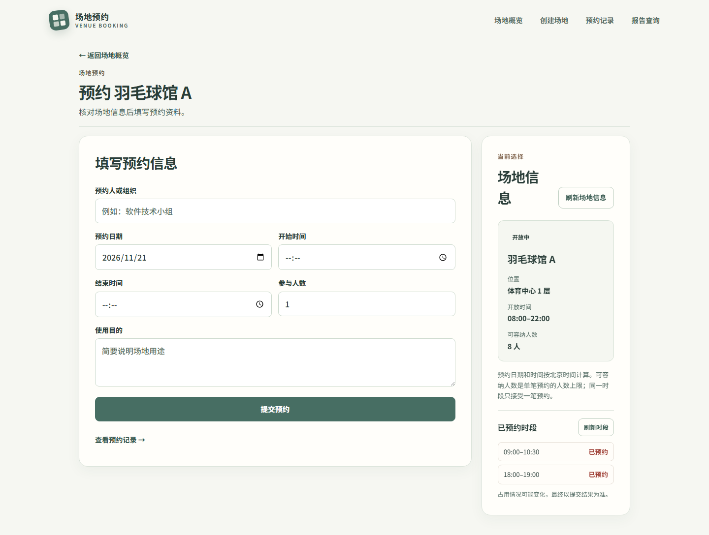
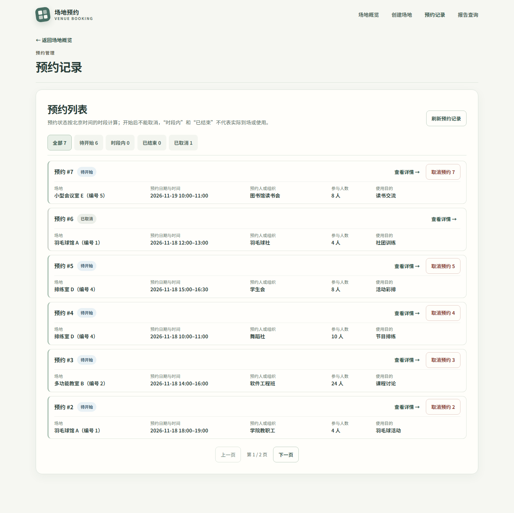

# 云原生软件技术 Lab 2 实验报告

## 1. 实验目标与系统概况

本实验将 Lab 1 的场地预约系统部署到 Kubernetes，保留场地管理、预约、冲突检查与取消等业务功能。在此基础上，新增预约统计报告和节点 DNS 检查任务，实践 Job、CronJob 与 DaemonSet。

本组采用 kind 集群。前端与 API 使用 Deployment，数据库使用 StatefulSet；报告任务和节点检查分别采用 Job、CronJob 与 DaemonSet。实际验收覆盖原有预约业务、多副本访问、数据持久化、一次性与定时报告，以及两个可调度节点的 DNS 检查，满足本实验的工作负载实践要求。

本组方案将一次性与定时报告统一为可按 Job ID 查询的持久化结果，并在页面呈现非零和零值统计；前端通过集群内 Service 访问 API，节点检查的脚本与就绪探针使用同一 DNS 目标，使页面、任务结果与资源状态便于核对。

### 1.1 Kubernetes 环境、版本、节点与镜像方式

部署及工作负载验收使用 Apple Silicon Mac 上的 Docker Desktop 作为容器引擎，并通过 kind CLI 创建 `venue-lab2` 集群。验收命令显式指定 `--context kind-venue-lab2`。三个节点是同一宿主机中的容器，不代表三台物理机器。

| 项目 | 实际配置 |
| --- | --- |
| 宿主机 | macOS、ARM64，物理内存 18 GiB |
| Docker | Desktop 4.64.0 / Engine 29.2.1，分配 11 CPU、约 7.65 GiB 内存 |
| kind / kubectl | v0.33.0 / v1.34.1 |
| Kubernetes | 三节点均为 v1.34.11，容器运行时为 containerd |
| 节点镜像 | `kindest/node:v1.34.11@sha256:44e222ee2132dab25ff87301682f89eb82c7880ea3a1bf543bfe9708fd08d67d` |
| 专项验收命名空间 | `venue-booking`，用于并发预约、任务重试和数据库 Pod 重建等验证 |
| 展示命名空间 | `venue-booking-final`，拥有独立 Secret、数据库和 PVC |

两个命名空间位于同一个验收集群，采用相同的资源拓扑，但数据库和 PVC 相互独立。展示命名空间用于查看固定业务数据和报告；会写入数据或重建 Pod 的专项验证在验收命名空间完成。隔离集成测试用于验证可捕获失败等异常路径，不计作集群实测。后文按此范围陈述结果。

集群配置保存在 [cluster.yaml](../k8s/kind/cluster.yaml)。`venue-lab2-control-plane` 带 `node-role.kubernetes.io/control-plane:NoSchedule` 污点；`venue-lab2-worker` 与 `venue-lab2-worker2` 无污点。三个节点均 Ready，工作负载调度至两个 worker；节点版本、架构和污点见[环境证据](lab2/evidence/kind-environment.json)。

自建镜像按 `linux/arm64` 构建，使用固定标签，并通过 `kind load docker-image <镜像:标签> --name venue-lab2` 装载到集群节点。官方 PostgreSQL 镜像使用 ARM64 平台归档装载。验收核对清单标签、节点镜像和实际 Pod imageID；镜像内容变化时使用新标签，避免 `IfNotPresent` 复用旧内容。

| 最终展示组件 | 固定镜像标签 |
| --- | --- |
| 前端 | `venue-booking-frontend:lab2-report-query-02` |
| API、手动报告与 CronJob | `venue-booking-api:lab2-20261113` |
| 节点检查 | `venue-booking-node-check:lab2-20261116-01` |
| 数据库 | `postgres:16.15-bookworm` |

### 1.2 系统架构图与组件通信路径

<figure>
  
  <figcaption>系统架构与组件通信路径。图中展示命名空间内的访问入口、Service、工作负载、数据库存储和节点检查关系。</figcaption>
</figure>

图示为展示命名空间的组件及其访问路径。前端和 API 方框分别合并表示 Service 及其后端 Deployment；`kubectl port-forward service/frontend` 按 Service 定位前端 Pod，浏览器不直接访问 ClusterIP。Nginx 将 `/api/` 请求代理到双副本 API；API 和两类报告 Job 经 `database` Service 访问 PostgreSQL。`database-headless` 只提供 StatefulSet 的稳定网络身份，不承担 JDBC 请求。手动 Job 由脚本创建，定时 Job 由 CronJob 创建；两者共用 API 镜像，不提供 HTTP Service。DaemonSet 在两个可调度 worker 上各运行一个 Pod，解析 `default` 命名空间中 Kubernetes Service 的完整 DNS 名称。ConfigMap 和 Secret 的用途见第 2.1—2.4 节；专项验收命名空间使用相同的工作负载结构和独立的数据存储。

### 1.3 系统运行与访问方式

部署清单与环境准备方法见[最终展示部署说明](../k8s/final/README.md)。现有展示环境位于 `venue-booking-final`；在承载验收集群的主机上执行以下命令访问前端：

```sh
kubectl --context kind-venue-lab2 -n venue-booking-final port-forward service/frontend 8080:80
```

随后从该主机的浏览器访问 `http://127.0.0.1:8080/`。前端经 `api` Service 调用业务接口；API 和报告任务通过 `database` Service 访问数据库，内部服务无需直接对外开放。

场地与预约操作在前端完成。一次性报告由 `scripts/create-report-job.py` 创建 Kubernetes Job，定时报告由 CronJob 自动生成；在 `#/reports` 页面输入 Job ID 可查询保存的结果。现有展示数据已配置完成，查看页面和报告时无需重新灌入数据或切换 CronJob 调度。DaemonSet 持续检查两个 worker 的集群 DNS。

源代码与 Kubernetes 部署配置保存在[项目仓库](https://github.com/Nianle-Li/cloud-native-software-tech-lab)。

## 2. Kubernetes 资源设计与系统实现

本章按组件的依赖关系，说明资源选择、访问路径和任务配置。运行结果见第 3 章。

### 2.1 资源清单与选择依据

| 资源类型 | 本组资源名称 | 承载的组件或任务 | 用途与选择理由 |
| --- | --- | --- | --- |
| Namespace | `venue-booking`、`venue-booking-final` | 资源隔离 | 分别承载专项验收与固定展示数据，避免写入和重建测试影响展示结果。 |
| Deployment | `api`（2 副本） | Spring Boot API | 无状态实例可共享数据库处理请求；Deployment 管理副本和滚动更新。 |
| Deployment | `frontend`（1 副本） | 前端页面与 Nginx | 持续提供页面及 API 代理；Deployment 管理无状态实例。 |
| StatefulSet | `database`（1 副本） | PostgreSQL | 提供稳定的 Pod 身份，并使数据库实例关联固定 PVC。 |
| Job | `venue-report-manual-<唯一后缀>` | 指定日期范围的报告 | 每次手动运行创建一次性任务，运行结束后退出；任务名用作报告 `job_id`。 |
| CronJob | `venue-report-daily` | 定时报告 | 按计划创建 Job，适合周期性执行且完成后退出的任务。 |
| DaemonSet | `node-check` | 节点 DNS 检查 | 在每个可调度节点运行一个检查 Pod，覆盖节点级环境。 |
| Service | `frontend` | 页面入口 | ClusterIP 为前端提供稳定的集群内入口；验收时通过端口转发访问，无需长期对外发布端口。 |
| Service | `api` | API 内部访问 | ClusterIP 的 `8080` 端口供前端 Nginx 代理访问，屏蔽 Pod IP 变化。 |
| Service | `database` | 数据库内部访问 | ClusterIP 的 `5432` 端口供 API 和报告任务访问，不对外暴露数据库。 |
| Service | `database-headless` | 数据库 Pod 身份 | 无头 Service 为 `database-0` 提供稳定 DNS 名称，配合 StatefulSet。 |
| ConfigMap | `venue-config` | 后端与数据库配置 | 保存数据库名、数据目录和 JDBC 地址等非敏感配置。 |
| ConfigMap | `frontend-nginx` | 前端代理配置 | 挂载 Nginx 配置，将 `/api/` 请求转发至 `api` Service。 |
| Secret | `venue-db-credentials` | 数据库凭据 | 保存账号和密码，并通过键引用注入容器，避免凭据写入清单。 |
| PVC | `postgres-data-database-0` | 数据库数据 | 由 StatefulSet 的卷声明模板创建；单副本数据库使用 `ReadWriteOnce` 卷，Pod 重建时复用原卷以保留业务与报告数据。 |

API 采用 2 副本，以核验 Service 对不同实例的访问和跨副本并发预约；两个无状态实例共享同一数据库。前端负责静态页面及 API 代理，现有功能验收无需并行实例，因此采用 1 副本；本实验未进行前端多副本负载或故障切换测试。数据库采用 1 副本，其本地 `ReadWriteOnce` 卷和当前 PostgreSQL 配置不构成数据库复制方案，因此不能通过增加副本实现高可用。

浏览器经端口转发访问 `frontend` Service，Nginx 将 `/api/` 请求转发至 `api` Service。API 和报告任务经 `database` Service 连接数据库；无头 Service 提供数据库 Pod 的稳定身份。Job、CronJob 和 DaemonSet 不接收业务入站请求，因此不单独配置 Service。数据库 Service 的 selector 限定数据库组件，不会误选其他 Pod。手动 Job 按需创建，完整资源名称及运行结果见[验收记录](lab2/acceptance.md)。

API 与手动、定时报告任务使用同一后端镜像，报告模式通过启动参数选择。报告结果写入数据库，不保存在 Job Pod 内。前端和节点检查 Pod 均设置资源请求、上限和就绪探针；前端另设启动与存活探针。两者都不需要 Kubernetes API 凭据，因此关闭 ServiceAccount token 自动挂载。

### 2.2 数据库、配置与 PVC 持久化

PostgreSQL 使用 `postgres:16.15-bookworm`。ConfigMap 中的 `POSTGRES_DB=venue_booking` 与 JDBC 地址 `jdbc:postgresql://database:5432/venue_booking` 一致；PVC 挂载于 `/var/lib/postgresql/data`，`PGDATA=/var/lib/postgresql/data/pgdata` 将数据库文件放入卷内子目录。API 和报告任务使用同一数据库 Service 和凭据，业务数据与报告结果均保存在该数据库中。

Secret 由 [create-k8s-db-secret.py](../scripts/create-k8s-db-secret.py) 在内存中生成随机密码，经标准输入创建到指定命名空间；密码不写入仓库、镜像或执行回传。重复执行保留已有 Secret；若 PVC 已存在而 Secret 丢失，脚本拒绝重新随机生成，以免与已初始化数据库的密码不一致。修改初始化环境变量不会自动轮换数据库密码。Secret 的编码不等于加密，本实验共用数据库初始化账号，未实现应用、迁移和报告账号的权限分离。

| 存储项 | 实测配置 |
| --- | --- |
| StorageClass | `standard`，默认类 |
| provisioner | `rancher.io/local-path` |
| 绑定模式 | `WaitForFirstConsumer`，等待 Pod 调度后供卷 |
| PVC | 请求 1Gi、ReadWriteOnce，实际 Bound |
| 回收策略 | StorageClass 为 Delete；StatefulSet 的 whenDeleted/whenScaled 均为 Retain |

选用当前 kind 集群默认的 `standard` 存储类，由 `rancher.io/local-path` 为 PVC 动态供卷。数据库只有一个实例，`ReadWriteOnce` 满足其挂载需求；申请的 1Gi 已用于本实验的业务与报告数据，并通过 Pod 重建验证了原卷复用。

StatefulSet 的保留策略避免删除或缩容控制器时自动删除声明，但不保证手动删除 PVC 后仍保留数据。PV 具有本地节点关联；本实验只验证同一集群内 Pod 重建，不宣称跨节点、跨主机或删除 kind 集群后的恢复能力。

数据库 requests 为 100m CPU/128Mi，limits 为 500m CPU/512Mi。startup、readiness、liveness 均用本地 TCP `pg_isready`；另通过其他 worker 的客户端验证 Service/DNS 和真实认证连接。Pod 关闭 ServiceAccount token 自动挂载。资源值是实验配置，不作为吞吐或高可用性能结论。

Flyway 是表结构的唯一来源，由 API 启动执行；数据库初始化目录不另建业务表。在独立临时 PostgreSQL 中对 V4 迁移完成 52 项核对，涵盖 V1–V3 原文件、空库迁移、从 V3 升级后的数据保留，以及报告主键、状态约束、非负统计和外键删除保护。[原始记录](lab2/evidence/flyway-v4-verification.json)属于独立验证；验收集群中的迁移结果另有 Flyway 启动记录。

### 2.3 后端 API、双副本与 Service

`api` Deployment 设为两个副本，容器监听 8080；同名 ClusterIP Service 只选择 API Pod，不暴露数据库端口。浏览器的 `/api` 请求先经前端 Nginx，再由 `api` Service 转发。API 和 Job 使用 `venue-config` 中的 JDBC 地址连接 `database:5432`，用户名与密码由 `venue-db-credentials` Secret 注入，清单没有写入实际凭据或 Pod IP。

API Pod 的 `POD_NAME` 由 Downward API 提供；`GET /api/instance` 返回该标识，用于核对请求到达的副本。startup/liveness 与 readiness 分别访问 Actuator 的 `/actuator/health/liveness` 和 `/actuator/health/readiness`；数据库可用性另以真实业务 API 操作验证。每个 API Pod 请求 100m CPU、256Mi 内存，上限为 500m CPU、512Mi 内存，并关闭不需要的 ServiceAccount token 自动挂载。

数据库就绪后由 API 启动执行 Flyway V1–V4；JPA 使用 `ddl-auto=validate` 检查映射，不另行改写表结构。两个副本共享 PostgreSQL，预约创建在事务中先锁定场地行，再检查有效预约的半开时段重叠并写入；取消也按场地优先的锁顺序执行。这样同一场地时段的并发请求由数据库串行化检查，而不是依赖请求落在哪个 Pod。

### 2.4 前端与报告查询页面

前端保留场地与预约页面，并新增 `#/reports` 查询入口。用户输入 Job ID 后，页面调用 `GET /api/reports/{job_id}`，显示任务状态、统计范围、执行时间及各场地的预约次数和分钟数。零预约场地仍显示为零值。页面只读取已保存的报告，不创建 Job，也不直接访问 Kubernetes API。

| 查询情况 | 页面反馈 |
| --- | --- |
| `RUNNING` | 显示运行中和刷新入口；长时间未更新时提示核对 Job，不自行推断任务结束。 |
| `SUCCEEDED` | 显示报告元数据和全部场地明细，包括零值行。 |
| `FAILED` | 显示错误摘要，并提示 Job 可能继续重试。 |
| 报告不存在、网络中断或响应结构无效 | 分别显示对应提示，避免把查询失败解释为任务失败。 |

页面校验 Job ID，并避免旧请求覆盖新查询结果。运行中、失败及请求异常由前端测试覆盖；集群中另验证了成功报告的实际查询。

Kubernetes 专用 Nginx 配置由 ConfigMap 提供，代理目标为 `api` Service。浏览器通过前端 Service 的端口转发访问系统；API 与数据库无需直接对外开放。

### 2.5 一次性报告 Job

`scripts/create-report-job.py` 根据起止日期和当前 API 镜像生成唯一名称的手动 Job。Job 容器沿用 `java -jar /app/app.jar` 入口，附加 `--spring.main.web-application-type=none`、`--report.run=true`，不启动 HTTP 服务。Pod 标签 `batch.kubernetes.io/job-name` 经 Downward API 注入为 `REPORT_JOB_ID`，另传 `REPORT_SOURCE=MANUAL`、`REPORT_START_DATE` 和 `REPORT_END_DATE`；成功退出码为 0，失败为非零。模板配置 `parallelism=1`、`completions=1`、`backoffLimit=1`、`activeDeadlineSeconds=1800`，关闭 ServiceAccount token 自动挂载。

Flyway V4 新增 `report_runs` 和 `report_items`。每个 `job_id` 对应一条运行记录，每个 `(job_id, venue_id)` 对应一条明细；数据库约束限制状态、来源、日期范围和非负统计值。统计对每个场地都生成一行，只计报告生成时状态为 `ACTIVE` 的预约，以结束时间减开始时间得到 `reserved_minutes`。这一字段表示已预约分钟数，不表示实际到场时长或百分比。

执行程序先持久化 `RUNNING`，再用单条 PostgreSQL 聚合查询取得一致快照，最后在一个事务中写入全部明细与 `SUCCEEDED`。同一 ID 已成功时直接沿用原快照；失败或残留 `RUNNING` 可按同来源和日期范围重试。数据库唯一约束、行锁和 Job 参数共同防止同 ID 的并发执行产生重复明细。可捕获的生成异常会保存脱敏的 `FAILED` 摘要；若进程在写入记录前终止，需结合 Kubernetes Job 状态和日志判断，不能由报告查询接口推断失败。

### 2.6 定时报告 CronJob

`venue-report-daily` 使用与一次性 Job 相同的报告程序。正式配置每日 00:10 统计前一日；短周期配置每 2 分钟统计当天，便于观察自动触发。两种配置只改变调度周期与统计窗口。

| 配置 | 正式模式 | 演示模式 |
| --- | --- | --- |
| `schedule` | `10 0 * * *` | `*/2 * * * *` |
| `timeZone` | `Asia/Shanghai` | `Asia/Shanghai` |
| `REPORT_WINDOW_MODE` | `PREVIOUS_DAY` | `TODAY` |
| `REPORT_SOURCE` | `SCHEDULED` | `SCHEDULED` |

每次触发生成独立 Job，其名称同时作为报告标识。`Forbid` 防止同一 CronJob 的任务重叠；补启动期限、重试次数和执行时长均受到限制。

CronJob Pod 通过 `database` Service 读取预约数据，结果由报告程序持久保存。`Forbid` 只约束同一 CronJob 的并行执行；同一报告任务的重复执行由报告程序处理。

### 2.7 节点 DNS 检查 DaemonSet

`node-check` 采用 DaemonSet，使每个符合调度条件的节点运行一个检查 Pod。脚本定期记录节点名称、宿主机地址和集群 DNS 解析结果；readiness 探针检查同一 DNS 名称，使就绪状态与任务结果一致。该任务无需 Service、特权容器或宿主机目录挂载。

集群中的两个 worker 可调度，control-plane 带 `NoSchedule` 污点。因此本实验的节点覆盖范围为两个 worker。

## 3. 系统使用与实验结果

本章展示业务操作和各类工作负载的运行结果。逐项判定与原始输出见[最终验收记录](lab2/acceptance.md)。

### 3.1 命名空间资源总览与配置核对

展示命名空间使用[最终 Kustomize 配置](../k8s/final/kustomization.yaml)，包含双副本 API、单副本前端和数据库、报告 CronJob、覆盖两个 worker 的 DaemonSet，以及所需的 Service、ConfigMap、Secret 和 PVC。资源核查结果为 API 2/2、前端 1/1、数据库 1/1、DaemonSet 2/2，数据库 PVC 为 Bound；镜像与第 1.1 节一致。页面中有五个名称可读的场地和七条预约，其中六条有效、一条已取消。

工作负载验收分为两个独立的数据范围：`kind-venue-lab2 / venue-booking-final` 用于展示页面、核对手动与两次自动报告及工作负载状态；同一集群的 `venue-booking` 用于双 Pod 并发预约、同 ID 任务重试和数据库 Pod 重建。两个命名空间各有独立数据库与 PVC，统计结果不跨命名空间合并。集成测试验证异常状态，结果单独说明。图 1—10 取自 A 在另一集群 `kind-venue-lab2-a / venue-booking-final` 的同一组固定展示数据，场地、预约、报告 Job ID 与图片摘要见[截图数据核对](lab2/evidence/report-screenshot-data.json)；图片中的 Job ID 与 C 在 `kind-venue-lab2` 的工作负载验收 Job ID 不混用。工作负载结论以[最终验收记录](lab2/acceptance.md)中各自对应的原始输出核对。

验收时先核对展示环境的节点、工作负载、镜像和 PVC，再经前端入口查看业务页面；以实际 Job ID 将一次性报告、两次自动 Job、API 响应和页面结果逐一对应，最后核对正式 CronJob 配置及两个 worker 的节点检查。并发、重试和数据库重建采用专项验收命名空间的独立证据，不在展示库重复写入或删除资源。完整的要求、判定与原始证据对应关系见[最终验收记录](lab2/acceptance.md)。

### 3.2 场地与预约业务流程

用户可按“浏览或创建场地 → 创建预约 → 查询记录 → 取消预约”的顺序完成业务操作。专项验收通过真实集群入口覆盖这一流程，并验证同一场地、时段的重复预约得到冲突反馈。页面请求经前端 Service 到达真实 API。展示环境的场地、预约和取消详情也已通过只读页面核对。

图 1 展示场地概览；图 2 显示已创建预约的详情，图 3 展示对同一场地时段再次提交时的冲突反馈；图 4 展示另一笔预约取消后的详情。创建、冲突与取消的业务回归结果见[最终验收记录](lab2/acceptance.md)，其余界面见附录。

<figure>
  
  <figcaption>图 1 场地概览与各场地的状态、位置、开放时段和容量。</figcaption>
</figure>

<figure>
  
  <figcaption>图 2 已创建预约显示编号、场地、预约时段与状态。</figcaption>
</figure>

<figure>
  
  <figcaption>图 3 重复提交已占用时段时，页面显示预约冲突和对应时段。</figcaption>
</figure>

<figure>
  
  <figcaption>图 4 已取消预约的状态与取消时间。</figcaption>
</figure>

### 3.3 API 双副本、Service 分流与并发预约

在专项验收命名空间，两个 API Pod 均为 `1/1 Ready`，分别位于两个 worker。经 `api` Service 建立的独立连接得到两个不同的 `/api/instance` 标识，证明请求可由两个副本处理。

对两个 Pod 同时提交同一场地、同一时段的预约请求，分别得到 **201** 和 **409 `TIME_CONFLICT`**；再次查询仅有一条有效预约。这表明副本共享数据库时，预约冲突检查仍生效。原始响应和 Pod 分布见[最终验收记录](lab2/acceptance.md)。

### 3.4 数据库 Pod 重建与业务数据保留

在专项验收命名空间，先保存场地、预约、报告的 API 响应和 Pod/PVC 标识，再重建 `database-0` Pod。StatefulSet 复用原 PVC；数据库就绪后，重新查询相同业务对象。

| 比较项 | 重建前后结果 |
| --- | --- |
| 数据库 Pod UID | 改变，确认实际创建了新 Pod |
| PVC UID、绑定 PV | 保持不变，PVC 为 Bound |
| 场地 | 同一 ID 的完整 API JSON 一致 |
| 预约 | 同一 ID 的完整 API JSON 一致，仍为 ACTIVE |
| 报告 | 同一 Job ID 的完整 API JSON 一致，仍为 SUCCEEDED，时间与明细保留 |

三个响应的前后比较均一致，Pod UID 改变而 PVC UID 与绑定 PV 保持不变；原始[恢复输出](lab2/evidence/booking-report-persistence/database-rollout.txt)与[比较结果](lab2/evidence/booking-report-persistence/database-rebuild-persistence.txt)可供复核。这证明了同一集群内数据库 Pod 重建后的业务数据保留，不代表跨节点或跨主机灾备。

### 3.5 一次性报告 Job 的执行、持久化与失败重试

展示命名空间中的一次性 Job 为 `Complete`；API 返回 `MANUAL / SUCCEEDED` 和五条场地明细。羽毛球馆 A 为 **2 次、150 分钟**，多功能教室 B 为 **1 次、120 分钟**，排练室 D 为 **2 次、150 分钟**，其余两个场地为零。场地名称、次数和分钟数与页面一致。

专项验收还验证了报告的持久化与幂等：删除已完成 Job 及 Pod 后，原报告仍可通过 API 查询；用相同 Job ID、来源和日期重建任务后，包含生成时间及明细的完整响应不变。数据库仍只有 1 条运行记录和 7 条场地明细。该结果来自专项验收命名空间，明细行数不与展示环境的五场地报告混用。

可捕获异常与同 ID 重试由隔离的 Testcontainers PostgreSQL 集成测试验证：异常发生后记录为 `FAILED`，摘要脱敏且明细为空；重试后转为 `SUCCEEDED`。报告集成测试 6 项、后端完整回归 21 项均通过。该失败状态是隔离测试结论，不作为集群中实际失败 Job 的记录。

### 3.6 报告查询页面

报告查询页通过 Job ID 读取已持久化的结果。展示环境中的一次性报告为 `MANUAL / SUCCEEDED`，五个场地的预约次数和分钟数与 API 逐行一致；已取消预约不计入统计。图 5 展示非零和零值行：羽毛球馆 A 与排练室 D 均为 2 次、150 分钟，多功能教室 B 为 1 次、120 分钟，另外两个场地为 0 次、0 分钟。这里的分钟数表示已预约时长，不表示实际到场时间或使用率。

运行中、失败和请求异常等页面反馈由前端测试验证；图 5 所示 Job ID、统计范围与 API 明细见[截图数据核对](lab2/evidence/report-screenshot-data.json)。

<figure>
  
  <figcaption>图 5 输入一次性任务的 Job ID 后，页面显示报告状态、日期范围及各场地统计。</figcaption>
</figure>

### 3.7 定时报告 CronJob 的自动执行

展示环境使用短周期配置核验自动调度。CronJob 连续创建了两个不同的 Job；两者的父资源均为 `venue-report-daily`，来源为 `SCHEDULED`，状态为 `SUCCEEDED`，统计范围相同。

| 自动执行 | 报告状态 | 有预约场地 | 零预约场地 |
| --- | --- | --- | --- |
| 第一次 | `SUCCEEDED` | 小型会议室 E：1 次、60 分钟 | 其余四个场地：0 次、0 分钟 |
| 第二次 | `SUCCEEDED` | 小型会议室 E：1 次、60 分钟 | 其余四个场地：0 次、0 分钟 |

两份报告均包含全部五个场地，结果与实际预约数据一致。自动创建关系、Job 资源及报告响应见[最终验收记录](lab2/acceptance.md)。图 6 显示自动报告的页面查询结果；图中 Job ID 和统计明细见[截图数据核对](lab2/evidence/report-screenshot-data.json)。

手动报告统计指定日期区间；短周期自动报告统计运行当天，因此两类报告的日期范围和非零场地可以不同。

<figure>
  
  <figcaption>图 6 输入自动任务的 Job ID 后，页面显示来源、成功状态及非零和零值统计。</figcaption>
</figure>

验收后已恢复正式配置：北京时间每日 00:10 统计前一日，`concurrencyPolicy=Forbid`。实际自动触发由短周期配置验证；正式配置通过恢复后的集群资源核对。

### 3.8 DaemonSet 的节点覆盖与检查结果

展示环境的 `node-check` 在两个可调度 worker 上各运行一个 Pod，DaemonSet 的期望数与就绪数均为 **2**。两个 Pod 的 DNS 检查结果均为 `dns=ok`。

| 节点 | Pod 就绪 | DNS 检查 |
| --- | --- | --- |
| `venue-lab2-worker` | 1/1 | `dns=ok` |
| `venue-lab2-worker2` | 1/1 | `dns=ok` |

control-plane 带 `NoSchedule` 污点，不在本清单的覆盖范围内。因此“每节点一个 Pod”对应当前两个可调度 worker，而非集群中的全部节点。

## 4. 小组分工与问题解决

### 4.1 李佳凝：前端功能与集群任务编排

李佳凝负责预约与报告查询前端、响应校验和浏览器回归，以及前端 Nginx 配置、Deployment 和 Service；同时维护正式与演示用 CronJob 清单、节点检查 DaemonSet、DNS 检查脚本和就绪探针，并整理最终展示环境、可读样例数据、展示核验脚本及相关说明。

前端验收覆盖业务页面、报告查询页面和集群入口。节点检查中，短名称 `kubernetes.default.svc` 在两个 worker 上无法解析，因此将脚本和就绪探针统一改为查询完整名称 `kubernetes.default.svc.cluster.local`；修复后两个 DaemonSet Pod 均就绪，日志均为 `dns=ok`，从而保证检查目标与就绪条件一致。相应运行结果见第 3 章。

### 4.2 张玳瑗：后端报告服务与并发控制

张玳瑗负责保留预约 API 与事务规则，新增 Flyway V4 报告表及 JPA 映射、统计程序、报告查询 API、实例标识 API、报告快照持久化和失败重试语义；同时负责双副本 API、一次性 Job 清单和手动触发脚本。API、手动 Job 和 CronJob 共用后端镜像。

两个 API Pod 同时处理同一时段预约时，数据库场地行锁使冲突检查与写入保持一致，集群中仅产生一条有效预约。报告使用唯一约束、行锁和同 ID 成功短路保护已生成的快照；Job 重试及数据库 Pod 重建后结果保持不变。可捕获失败的 `FAILED` 状态由隔离集成测试验证。

### 4.3 吴柯蝶：集群基础设施与持久化验收

吴柯蝶负责 kind 集群和有状态基础设施，包括数据库 StatefulSet、Service、PVC、ConfigMap、Secret、镜像装载及环境准备；复核 V4 迁移与约束，确保数据库、配置和存储资源能够按清单复现。

吴柯蝶执行集群部署、最终展示环境部署、数据库 Pod 重建，以及 CronJob 和 DaemonSet 复测，并整理环境、存储和验收证据。镜像按宿主机 ARM64 架构构建并装载后，核对节点缓存和实际 Pod，避免多架构缓存影响 kind 装载。数据库通过独立 PVC 保存业务与报告数据；Pod 重建后，原场地、预约和报告仍可查询。展示环境使用独立数据库和 PVC，使固定样例不受专项验收写入影响。


## 5. 项目总结

本实验将场地预约系统部署到 Kubernetes，按组件特征组合 Deployment、StatefulSet、Job、CronJob 和 DaemonSet，并使用 Service、ConfigMap、Secret 与 PVC 完成访问、配置和持久化。业务操作与报告查询可用，两个 API 副本均可处理请求；一次性报告可持久查询，CronJob 连续两次自动生成正确报告，DaemonSet 在两个可调度 worker 上通过 DNS 检查。正式 CronJob 已恢复每日调度配置，集群展示和专项验收的结果均有对应证据。

## 附录：补充业务界面

以下画面补充展示表单、场地详情、已占用时段和预约列表。

<figure>
  
  <figcaption>图 7 创建场地表单包含名称、位置、容量和开放时段等输入项。</figcaption>
</figure>

<figure>
  
  <figcaption>图 8 排练室 D 的场地详情与预约入口。</figcaption>
</figure>

<figure>
  
  <figcaption>图 9 羽毛球馆 A 的预约表单显示两个已占用时段。</figcaption>
</figure>

<figure>
  
  <figcaption>图 10 预约记录列表展示状态筛选、记录内容与分页。</figcaption>
</figure>
